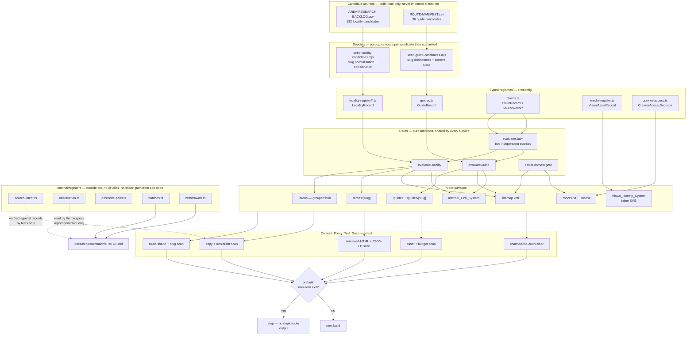
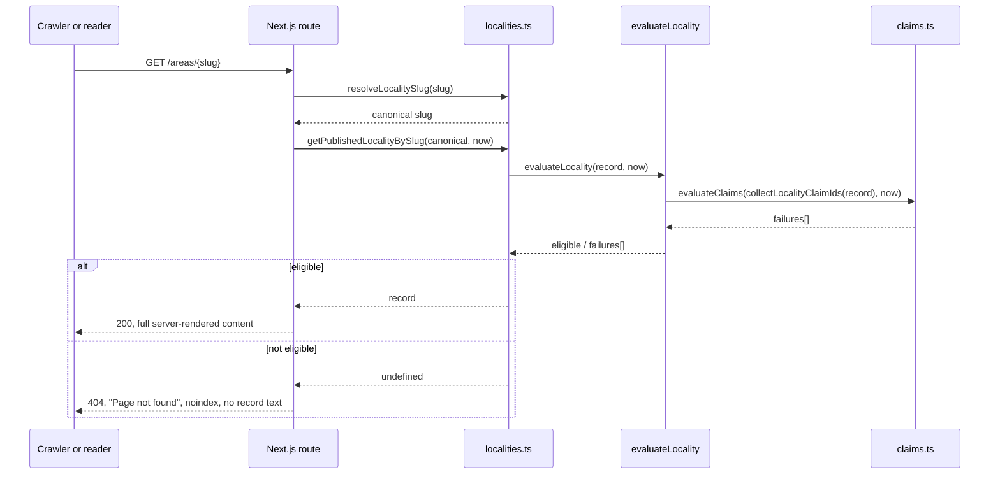
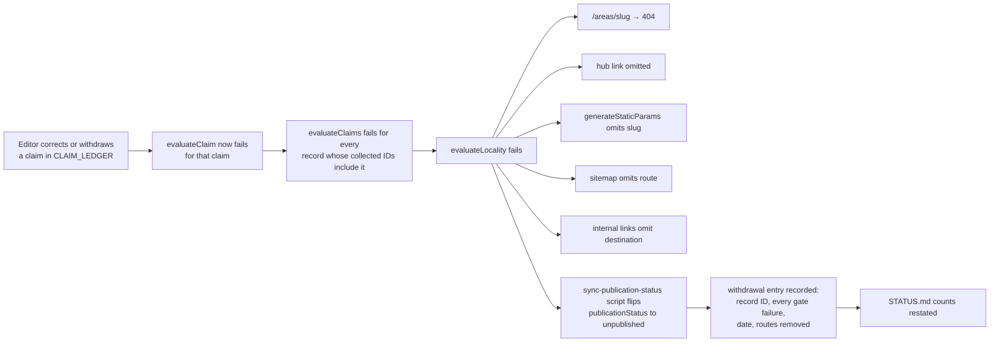
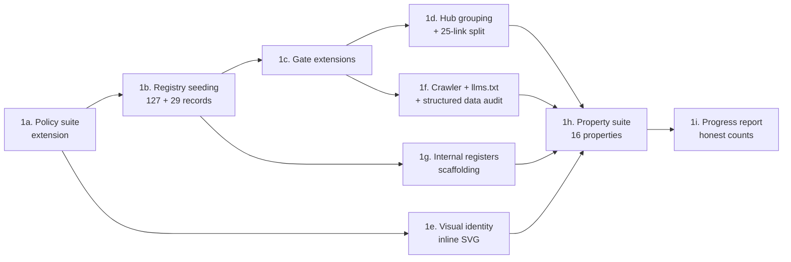

# Design Document

## Overview

This feature turns a 15-page site into a content system that can carry a hundred or more genuinely distinct pages, be read correctly by AI search tools, answer the phrases Bengaluru customers actually type, and look recognisably local — without photography and without weakening any evidence gate already in place.

### The one substitution

The owner asked for permutation routes: `buy-flat-indiranagar`, `sell-villa-hebbal`, `best-broker-<area>`, `pincode-<code>`. That pattern is named twice in [Google's search spam policies](https://developers.google.com/search/docs/essentials/spam-policies) — as **doorway pages** and as **scaled content abuse** — and the documented outcome is demotion or removal from the index. AI search tools do not count pages either; they cite pages that answer one question well. So the 100-plus page goal is met by researching and publishing distinct pages from the candidate pool the repository already holds: **132** locality and corridor candidates in `docs/seo-launch-handoff/AREA-RESEARCH-BACKLOG.csv` and **36** guide candidates in the `guide` family of `docs/seo-launch-handoff/ROUTE-MANIFEST.csv`, **168** in total. Keyword coverage moves *inside* those pages — into the `<h1>`, the section headings and the direct answer — rather than across duplicated URLs. Requirement 12 converts the rejected pattern into build-breaking assertions so nobody can reintroduce it later without noticing.

That substitution is stated once here and enforced in Requirement 12. The rest of this document does not re-argue it.

### What this extends rather than replaces

Four things are already implemented, tested and passing:

| Existing mechanism | Where | Status in this design |
|---|---|---|
| Per-claim evidence check | `evaluateClaim` / `evaluateClaims` in `src/config/claims.ts` | Unchanged. Called, never relaxed. |
| Locality publication gate | `evaluateLocality` in `src/config/localities.ts` | Extended with one **additional** failure condition (Requirement 1.14, unevidenced boundary version). No existing condition removed. |
| Guide publication gate | `evaluateGuide` in `src/config/guides.ts` | Extended with **additional** conditions (direct-answer word bound, section count, maintenance owner, review date, classifier agreement). No existing condition removed. |
| Domain gate | `src/config/site.ts`, `src/lib/metadata.ts` | Unchanged. Gates `llms.txt` and the per-agent robots groups too. |

Today **zero** locality records pass the gate and **three** guides pass it. This design does not change that count. It builds the machinery that lets the count rise as evidence and owner answers arrive, and it makes the count visible and honest while it is low.

### What cannot be delivered without the owner

Locality publication, external-fact guides, photography, the observation panel and every absolute URL depend on answers only the owner has. Each dependency is named in the [Owner Dependencies](#owner-dependencies) table against its `OWNER-FACTS-CHECKLIST.md` ID. Nothing is invented in the meantime; capabilities stay switched off and say so.

### Design principles carried through every section

1. **The gate is the only visibility rule.** Navigation, `generateStaticParams`, `generateMetadata`, the sitemap, internal links and `llms.txt` all call the same function with the same `now`. No surface holds a second opinion.
2. **Fail closed.** An unknown slug, an absent environment value, an unrecorded decision and a missing asset all resolve to the restrictive outcome: 404, `Disallow: /`, no image.
3. **Internal registers are structurally unreachable from `src/`.** The search-intent and observation registers live outside the app's module graph, so "must not appear on a public route" is a property of the directory layout, not of anybody's discipline.
4. **Server components by default.** Every component this feature adds renders on the server. The only new interactivity is a native `<details>` disclosure, which is zero JavaScript.
5. **Measured, not asserted.** Contrast, asset weight, script weight, overflow and word counts are computed by tests from the real source values.

---

## Architecture



### Where the internal registers sit, and why it is a directory decision

Requirements 3.12 and 7.8 say no register entry may appear on a public route, in server-rendered HTML or in a sitemap. A test that greps for leakage is a check; a directory that cannot be imported is a guarantee.

The registers go in `internal/registers/` at the repository root:

- `tsconfig.json` maps `@/*` to `src/*` only, so `@/...` cannot reach them.
- `next.config.ts` compiles from `src/app`; a relative import from `src/` up into `internal/` would be an obvious `../../internal/` path, and a policy test asserts no file under `src/` contains that substring.
- `vitest.config.ts` gains a second alias, `@internal/*` → `internal/*`, available to tests and to `scripts/` but not used anywhere in `src/`.

The consequence for Requirement 3.6 is important. A page must *render* its primary intent phrase, but the page may not read the register. So the **approved phrase text** is copied onto the locality or guide record when the record is approved, and the register keeps the evidence behind it — the tool, the date, the location context, the volume. A test imports both sides and asserts every record phrase traces to a register entry. The page reads only record fields.

### Request-time flow for a locality page



The gate is evaluated per request with the current date, so an expired recheck, a corrected claim or a withdrawn approval takes effect on the next request without a rebuild. That is what makes Requirements 1.12, 11.6 and 11.7 automatic rather than procedural.

---

## Data Models

All new types are plain interfaces in TypeScript 5.9, `readonly` throughout, with `null` meaning *not supplied* and never *zero* or *unknown-but-probably-fine*.

### Search intent register

```ts
// internal/registers/search-intent.ts

/** How a phrase was found. A named tool or a named manual method — never neither. */
export type PhraseSource =
  | { readonly kind: 'tool'; readonly toolName: string }
  | { readonly kind: 'manual'; readonly methodName: string };

/** Bengaluru, or a named locality within it. Requirement 3.1. */
export type LocationContext =
  | { readonly scope: 'city'; readonly city: 'Bengaluru' }
  | { readonly scope: 'locality'; readonly city: 'Bengaluru'; readonly locality: string };

/**
 * A volume figure is only a figure when every condition in Requirement 3.2 is
 * recorded. `evaluateVolume` below is what decides whether it may be used.
 */
export interface VolumeObservation {
  readonly figure: number;
  readonly toolName: string;
  /** Calendar date, YYYY-MM-DD. */
  readonly queriedOn: string;
  readonly toolSettings: {
    readonly locationSetting: string;
    readonly languageSetting: string;
    readonly dateRangeApplied: string;
  };
  /** At most 180 days after queriedOn. Requirement 3.2. */
  readonly reQueryBy: string;
}

export type VolumeAvailability =
  | { readonly available: true; readonly figure: number }
  | { readonly available: false; readonly reason: string };

export interface SearchIntentEntry {
  readonly entryId: string;
  /** At most 120 characters. Requirement 3.1. */
  readonly phrase: string;
  readonly source: PhraseSource;
  /** Single calendar date the phrase was observed. */
  readonly observedOn: string;
  readonly locationContext: LocationContext;
  /** The single customer question the phrase asks. Requirement 3.1. */
  readonly primaryIntentQuestion: string;
  /** Route that serves this intent, or null while unassigned. */
  readonly destinationRoute: string | null;
  /** 'primary' — one per page. 'supporting' — at most 5 per page. */
  readonly role: 'primary' | 'supporting';
  readonly volume: VolumeObservation | null;
}

/** Requirement 3.8 and 3.9. A position is a dated sample, never a ranking. */
export interface CompetitorObservation {
  readonly observationId: string;
  readonly queryText: string;
  readonly observedOn: string;
  readonly toolName: string;
  readonly locationContext: LocationContext;
  readonly resultType: 'organic' | 'map' | 'paid' | 'ai-answer';
  /** Null unless a position was actually seen on that date through that tool. */
  readonly positionSample: number | null;
}
```

Two pure functions govern use:

```ts
/** Requirement 3.13. An entry missing a required field is held out of editorial use. */
export function evaluateIntentEntry(
  entry: SearchIntentEntry
): { readonly usable: boolean; readonly missingFields: readonly string[] };

/** Requirement 3.2, 3.3 and 3.15. Never substitutes an estimate. */
export function evaluateVolume(
  entry: SearchIntentEntry,
  now: Date
): VolumeAvailability;
```

`evaluateVolume` returns unavailable when `volume` is null, when any of `toolName`, `queriedOn` or the three settings is empty, or when `now >= reQueryBy`. There is no rounding branch and no inference branch — that is the whole point of Requirement 3.3.

### Observation register

```ts
// internal/registers/observation.ts

export type ObservationTool =
  | 'google-organic'
  | 'google-maps'
  | 'chatgpt-search'
  | 'perplexity'
  | 'bing-copilot';

/** Requirement 7.1. Exactly 10, each with a stable identifier. */
export interface BenchmarkQuestion {
  readonly questionId: string;            // OBS-Q01 … OBS-Q10
  readonly questionText: string;
  /** False excludes the question from every round and every count. */
  readonly reportable: boolean;
  /** Required when reportable is false. Names the blocking owner input. */
  readonly exclusionReason: string | null;
}

/** Requirement 7.11. A field that could not be determined is recorded, not guessed. */
export type Determined<T> =
  | { readonly available: true; readonly value: T }
  | { readonly available: false; readonly reason: string };

/** Requirement 7.3. Google Maps with no confirmed presence is not-applicable. */
export type Applicability<T> =
  | { readonly applicable: true; readonly result: Determined<T> }
  | { readonly applicable: false; readonly reason: string };

export interface ObservationEntry {
  readonly questionId: string;
  readonly roundId: string;               // OBS-R001 …
  readonly tool: ObservationTool;
  readonly observedOn: string;
  /** A real named person. Requirement 7.2 and 7.4. */
  readonly observer: string;
  readonly locationContext: LocationContext;
  readonly mentioned: Applicability<boolean>;
  /** The URL the tool cited, or the literal 'none'. */
  readonly citedUrl: Determined<string | 'none'>;
  /** Whether the tool reported exactly `INSTLE REAL ESTATE`. */
  readonly brandStringMatchesExactly: Determined<boolean>;
  /** Whether the tool reported exactly `9353096264`. */
  readonly phoneMatchesExactly: Determined<boolean>;
  /** Empty array means none observed. Requirement 7.2. */
  readonly factualErrors: readonly string[];
  /** Requirement 7.6. Required within 5 working days when factualErrors is non-empty. */
  readonly correction: ObservationCorrection | null;
}

export interface ObservationCorrection {
  readonly incorrectFact: string;
  /** The route that should carry the correct fact. */
  readonly pageThatShouldCarryTheFact: string;
  readonly correctionMade: string;
  readonly correctedOn: string;
}

export interface SamplingRound {
  readonly roundId: string;
  readonly startedOn: string;
  /** At most 2 calendar days after startedOn. Requirement 7.10. */
  readonly completedOn: string | null;
  readonly observer: string;
  readonly locationContext: LocationContext;
}
```

The ten benchmark questions are fixed by Requirement 7.1 and seeded with `reportable` set from the owner state: the commercial-broker question starts `reportable: false` with `exclusionReason` naming checklist entry C4, and the Google Maps tool rows start not-applicable until a Maps presence is confirmed.

### Benchmark question seed

| ID | Question | Initial reportable |
|---|---|---|
| OBS-Q01 | Who is a broker for selling an apartment in Bengaluru? | yes |
| OBS-Q02 | How do I choose a broker to sell my flat? | yes |
| OBS-Q03 | Who can help me buy an apartment in Bengaluru? | yes |
| OBS-Q04 | Who is a broker for renting out a house in Bengaluru? | yes |
| OBS-Q05 | Which brokerage works near <confirmed area>? | no — checklist C1 unconfirmed |
| OBS-Q06 | What is the contact number for INSTLE REAL ESTATE? | yes |
| OBS-Q07 | Who is Utpal Raj KB? | yes |
| OBS-Q08 | Who helps with resale in <published locality>? | no — no locality passes the gate |
| OBS-Q09 | Who is a commercial property broker in Bengaluru? | no — checklist C4 unconfirmed |
| OBS-Q10 | Can a broker guarantee a sale in 30 days? | yes |

OBS-Q05 and OBS-Q08 become reportable automatically once the condition they name is satisfied; the seed records the condition rather than a placeholder area name.

### Locality record extensions

Deliberately minimal. `LocalityRecord` already carries `marketingGroup`, `administrativeMappings` with `boundaryVersion`, `actualServiceCoverage`, `coverageResponsibleOwner`, the three reviewer fields, the three approval timestamps, `sourceCheckedAt`, `nextReviewAt`, `contentUpdatedAt`, `approvedNearbyRelationships` with a `relationship` string and `claimId`, `postalMappingIds` and `imageRightsRecords`. Three fields are genuinely absent:

```ts
export interface LocalityRecord {
  // … every existing field unchanged …

  /**
   * Requirement 3.6. The approved primary intent phrase, copied here at approval
   * so the page can render it without reading the internal register.
   */
  readonly primaryIntent: { readonly intentEntryId: string; readonly phrase: string } | null;

  /** Requirement 3.6. At most 5. Each may appear at most 3 times in the body. */
  readonly supportingPhrases: readonly string[];

  /** Requirement 9.2. Media_Register asset IDs this page renders. */
  readonly visualAssetIds: readonly string[];
}
```

`imageRightsRecords` is retained unchanged for photographs supplied under Requirement 10; illustrations and maps are referenced by `visualAssetIds` because they are components, not files, and their provenance lives in the Media_Register.

### Workflow state, derived rather than stored

Requirement 11.1 needs eight states. `editorialStatus` has seven (`candidate` … `approved`) and `publicationStatus` has two. Rather than change either type and churn the passing tests, the eight-state view is derived:

```ts
// src/config/editorial-workflow.ts

export type WorkflowState =
  | 'candidate' | 'research' | 'draft' | 'fact_review'
  | 'editorial_review' | 'seo_review' | 'approved' | 'published';

export const WORKFLOW_SEQUENCE: readonly WorkflowState[] = [
  'candidate', 'research', 'draft', 'fact_review',
  'editorial_review', 'seo_review', 'approved', 'published',
] as const;

export function deriveWorkflowState(record: {
  readonly editorialStatus: EditorialStatus;
  readonly publicationStatus: LocalityPublicationStatus;
}): WorkflowState {
  return record.publicationStatus === 'published' ? 'published' : record.editorialStatus;
}

export type TransitionResult =
  | { readonly ok: true; readonly next: WorkflowState }
  | { readonly ok: false; readonly error: string };

/** Requirement 11.1 and 11.11. Forward one step, or back any number of steps. */
export function transition(from: WorkflowState, to: WorkflowState): TransitionResult;

/** Requirement 11.2 and 11.3. */
export function validateApprovalSignOff(record: LocalityRecord): {
  readonly ok: boolean;
  readonly failures: readonly string[];
};
```

`validateApprovalSignOff` enforces three distinct, attributable names and the timestamp ordering `localReviewApprovedAt <= editorialApprovedAt <= seoReviewApprovedAt`, reusing `NON_ATTRIBUTABLE_REVIEWER_NAMES` from `claims.ts` so "research desk" is rejected in one place rather than two.

### Batch, withdrawal and postcode registers

```ts
// internal/registers/batches.ts
export interface ContentBatch {
  readonly batchId: string;                       // BATCH-001 …
  readonly recordIds: readonly string[];
  readonly localReviewer: string;
  readonly editorialApprover: string;
  readonly seoReviewer: string;
  readonly releasedOn: string | null;
}

// internal/registers/withdrawals.ts — Requirement 11.9
export interface WithdrawalEntry {
  readonly recordId: string;
  /** Every failure string the gate returned, not a summary. */
  readonly gateFailures: readonly string[];
  readonly withdrawnOn: string;
  readonly routesRemoved: readonly string[];
}

// internal/registers/postcode-pairs.ts — Requirement 12.4. Never rendered.
export interface PostcodePair {
  readonly pairId: string;
  readonly localitySlug: string;
  readonly postcode: string;
  /** At least two, from at least two independence groups. */
  readonly sources: readonly SourceRecord[];
  readonly boundaryVersion: string;
  readonly reviewer: string;
}
```

### Media register and visual assets

```ts
// src/config/media-register.ts

export interface MediaProvenance {
  readonly creator: string;
  readonly sourceReference: string;
  readonly licenceName: string;
  readonly licenceTerms: string;
  readonly permissionToAdapt: 'granted' | 'refused';
  /** Calendar date. */
  readonly acquiredOn: string;
  /** Requirement 10.11. Null means no expiry recorded. */
  readonly licenceExpiresOn: string | null;
}

/** Requirement 10.3. Required for any recognisable face. */
export interface PersonRelease {
  readonly personName: string;
  readonly permittedUses: readonly string[];
  readonly releasedOn: string;
}

interface VisualAssetBase {
  readonly assetId: string;
  /**
   * Inline SVG is a server component; a file lives under /public. Illustrations
   * and maps in this feature are all inline, so they cost zero extra requests.
   */
  readonly delivery:
    | { readonly mode: 'inline-svg'; readonly componentName: string }
    | { readonly mode: 'file'; readonly publicPath: string };
  readonly intrinsicWidth: number;
  readonly intrinsicHeight: number;
  /** 1–125 characters, or null when `decorative` is true. */
  readonly altText: string | null;
  readonly decorative: boolean;
  /** Requirement 9.2. The named Bengaluru subject. */
  readonly subject: {
    readonly kind: 'locality' | 'corridor' | 'civic-motif';
    readonly name: string;
  };
  readonly provenance: MediaProvenance;
  /**
   * Requirement 9.5. Every colour the asset presents behind text. The token test
   * computes 4.5:1 for the text colour against each of these.
   */
  readonly backgroundColoursBehindText: readonly string[];
  /** Measured, not estimated. Requirement 9.17 and 10.7. */
  readonly compressedBytes: number;
}

export interface IllustrationAsset extends VisualAssetBase {
  readonly kind: 'illustration';
  /** Generic nouns only. Checked against a lexicon. Requirement 9.4. */
  readonly depicts: readonly string[];
  /** Visible text that labels the asset an illustration. Requirement 9.4. */
  readonly illustrationLabel: string;
}

export interface MapAsset extends VisualAssetBase {
  readonly kind: 'map';
  /** Visible text labelling the map an orientation aid. Requirement 9.3. */
  readonly orientationAidLabel: string;
  /** A boundary is drawn only from a claim that passed the gate. */
  readonly boundaryClaimId: string | null;
  /** Both structurally false — the type forbids the value. Requirement 9.3. */
  readonly showsCommuteTimes: false;
  readonly showsDistances: false;
}

export interface TextureAsset extends VisualAssetBase {
  readonly kind: 'texture';
  readonly decorative: true;
  readonly altText: null;
}

/** Requirement 10. Nothing of this kind exists yet. */
export interface PhotographAsset extends VisualAssetBase {
  readonly kind: 'photograph';
  readonly personRelease: PersonRelease | null;
  /** At most 120 characters: area name and date taken only. Requirement 10.6. */
  readonly caption: string | null;
  readonly showsRecognisableFace: boolean;
  readonly showsBuildingOrStreet: boolean;
}

export type VisualAssetRecord =
  | IllustrationAsset | MapAsset | TextureAsset | PhotographAsset;

/** Requirements 9.13, 10.1, 10.2, 10.3, 10.11. */
export function evaluateAsset(
  asset: VisualAssetRecord,
  now: Date
): { readonly renderable: boolean; readonly failures: readonly string[] };
```

`showsCommuteTimes: false` as a literal type rather than a boolean is deliberate: a map asset that claims to show commute times will not compile.

### How 132 CSV candidates become records

`scripts/seed-locality-candidates.mjs` reads the CSV — the real columns are `candidate_id, candidate_name, candidate_slug, entity_type_provisional, research_group_not_official_zone, priority, proposed_route, unique_research_question, coverage_status, claim_status, editorial_status, publication_status, pin_codes_unverified_blank, source_1_exact_url, source_2_independent_exact_url, actual_reviewer, approved_at, next_review_at, alias_merge_notes` — and emits typed records into `src/config/locality-registry/`, split by research group so no file is unreviewable. Column mapping:

| CSV column | Record field | Transform |
|---|---|---|
| `candidate_id` | `entityId` | `AREA-001` → `LOC-BLR-AREA-001`, kept unique |
| `candidate_name` | `canonicalName` | verbatim |
| `candidate_slug` | `slug` | verbatim, then collision rule below |
| `entity_type_provisional` | `entityType` | `locality`/`corridor` map directly; `junction-area` and `outer-place` map to `micro-locality` with the original value preserved in a blocking note, because neither is a settled entity type |
| `research_group_not_official_zone` | `marketingGroup` | "North and north-east research group" → "North and north-east", with the browsing-aid note supplied by the hub rather than the value |
| `unique_research_question` | `blockingNotes[0]` | prefixed "Research question: " |
| `priority` | batch ordering input | not a record field |
| everything else | — | every remaining field set to the Requirement 1.2 initial value |

Requirement 1.2 fixes the initial state for every seeded record: `actualServiceCoverage: 'unconfirmed'`, `coverageResponsibleOwner: null`, `editorialStatus: 'candidate'`, `publicationStatus: 'unpublished'`. Every other field is an explicit `null` or empty collection — never a plausible-looking default. The `summary` is set to the honest candidate sentence the five existing records already use, and is never rendered because the record cannot pass the gate.

**The slug collision rule (Requirement 1.15).** The CSV has no internal duplicates, but three candidates collide with records already in the registry:

| Candidate | Collides with | Resolution |
|---|---|---|
| `AREA-016` Sadashivanagar → `sadashivanagar` | existing `LOC-BLR-SADASHIVANAGAR` | candidate **not** added; open entity-boundary decision recorded |
| `AREA-053` Indiranagar → `indiranagar` | existing `LOC-BLR-INDIRANAGAR` | candidate **not** added; decision recorded |
| `AREA-077` Koramangala → `koramangala` | existing `LOC-BLR-KORAMANGALA` | candidate **not** added; decision recorded |

Two more need a decision rather than a merge: `AREA-021` Hebbal → `hebbal` does not collide textually with the preserved `north-bengaluru` slug, but the existing record is *named* Hebbal on that slug, so seeding `hebbal` would create two records for one entity. And `AREA-055` Whitefield → `whitefield` overlaps `whitefield-inner-enclaves`. Both are held out and recorded as open, exactly as Requirement 1.10 requires for `north-bengaluru` until `DECISION-LOG.md` D-IMPL-06 closes.

So the seeding algorithm is:

```
for each candidate, in CSV order:
  slug := candidate_slug
  if slug is a key in LOCALITY_SLUG_ALIASES            -> hold out, record collision
  if slug equals an existing record's slug             -> hold out, record collision
  if slug equals an already-seeded candidate's slug    -> hold out, record collision
  if canonicalName equals an existing record's name
     or appears in an existing record's aliases        -> hold out, record entity-boundary decision
  otherwise                                            -> add the record
```

Held-out candidates are not discarded. They are written to `internal/registers/entity-boundary-decisions.ts` with the colliding slug, both candidate IDs and the question to be answered, so the 168-candidate accounting in Requirement 13.2 still sums correctly. Expected result: **127 records seeded, 5 held for an entity-boundary decision, 5 existing records retained** — 132 candidates accounted for, 132 registry records after the existing five are counted, and a separately visible list of what needs deciding.

### How 36 guide candidates become records

`scripts/seed-guide-candidates.mjs` reads the `guide`-family rows of `ROUTE-MANIFEST.csv` (`route_id, path, family, primary_user_intent, proposed_title, priority, …`). `path` gives the slug, `primary_user_intent` maps to `CustomerIntent`, `proposed_title` becomes the working title. Every record is seeded `publicationStatus: 'unpublished'` with empty `sections`, an empty `directAnswer` and `contentUpdatedAt: null`, so Requirement 4.6 holds it out of every public surface from the moment it exists.

**Seven manifest slugs violate Requirement 4.9 and must be renamed at seeding.** The rule forbids two published guides whose slugs differ only by an area name, a property-type word or an intent word. The manifest carries exactly that pattern:

| Manifest slug | Collides with | Seeded slug |
|---|---|---|
| `sell-flat-bengaluru` | `buy-flat-bengaluru` (intent word) | `what-happens-when-you-list-a-flat-for-sale` |
| `buy-flat-bengaluru` | `sell-flat-bengaluru` (intent word) | `what-to-check-before-you-agree-to-buy-a-flat` |
| `rent-home-bengaluru` | `rent-out-flat-bengaluru` (intent word) | `how-a-rental-search-actually-proceeds` |
| `rent-out-flat-bengaluru` | `rent-home-bengaluru` (intent word) | `what-a-landlord-decides-before-listing` |
| `buy-villa-checklist` | `buy-site-plot-checklist` (type word) | `questions-a-villa-purchase-raises` |
| `buy-site-plot-checklist` | `buy-villa-checklist` (type word) | `questions-a-site-purchase-raises` |
| `independent-house-checklist` | the two above (type word) | `questions-an-independent-house-purchase-raises` |

The renames are not cosmetic. A slug that names the *question* rather than the *permutation* is what makes the page distinct, and the distinctness check runs on the seeded slugs so a future addition cannot reintroduce the pattern. The detection function is:

```ts
/**
 * Requirement 4.9. Two slugs collide when their token multisets differ only by
 * tokens drawn from the intent, property-type or area lexicons.
 */
export function slugsDifferOnlyByPermutationToken(a: string, b: string): boolean;
```

Tokens are the hyphen-separated parts. `INTENT_TOKENS` = buy, sell, rent, rent-out, let, purchase, buying, selling, renting. `TYPE_TOKENS` = flat, apartment, villa, plot, site, house, independent, commercial, office, shop, showroom, warehouse. `AREA_TOKENS` is every `canonicalName` and alias in the locality registry, lowercased and hyphenated, plus `bengaluru` and `bangalore`.

One more manifest slug needs an explicit ruling. `pin-code-locality-difference` is a legitimate guide — explaining that a PIN code is not a locality is exactly the kind of thing that stops a reader being misled. Requirement 12.3 forbids a *route segment matching* `pin`, `pin-code`, `pincode`, `pincodes`, `postcode` or `postal-code`. The design reads "matching" as **whole-segment equality**, not substring containment, so `pin-code-locality-difference` is permitted while `/pin-codes` and `/areas/560001` are not. The second half of 12.3 still binds: the guide may explain the concept but may not present any six-digit numeral as a PIN code. This interpretation is written into the test as a named constant with the reasoning beside it, so it is a recorded decision rather than a loophole.

---

## Components and Interfaces

### 1. Locality scaling

#### Batch model

Requirement 1.8 sets the pace: first batch 8–12 records, later batches 10–15, and a batch stays unreleased until it meets its minimum. Review capacity, not ambition, governs release.

```ts
// src/config/editorial-workflow.ts

export function validateBatch(
  batch: ContentBatch,
  isFirstBatch: boolean,
  records: readonly LocalityRecord[],
  now: Date
): { readonly releasable: boolean; readonly failures: readonly string[] };
```

It fails the batch when: any member record fails `evaluateLocality`; the size is outside 8–12 (first) or 10–15 (later); any of the three reviewer names is missing, non-attributable or duplicated against another of the three. A batch that fails is held — there is no partial release, because a partial release is how a half-reviewed record reaches the index.

Batch ordering starts from the twelve `P1-first-batch-candidate` rows, minus the four held for an entity-boundary decision, which leaves **eight**: Yelahanka, Marathahalli, HSR Layout, Jayanagar, JP Nagar, Electronic City, Rajarajeshwari Nagar and whichever of the held five the entity decision releases first. Eight is exactly the first-batch minimum, which is a coincidence worth noting rather than relying on: if the entity decision goes the other way the first batch waits for a ninth researched record.

#### Deterministic ordering for the area hub

Requirement 2.2 demands that the same record set always produces the same page. Locale-aware collation is not dependable for that — ICU data differs between the build machine and the runtime. So ordering uses a pure, explicit comparator:

```ts
// src/lib/locality-grouping.ts

/** Lowercase, strip diacritics, collapse non-alphanumerics to a single space. */
function orderingKey(value: string): string;

/** Code-point compare on orderingKey; ties broken by the raw string. Total order. */
export function compareByName(a: string, b: string): number;
```

For the Latin place names in this registry that is alphabetical order, and it is byte-identical on every machine.

#### Grouping and the 25-link rule

```ts
export interface LocalityGroup {
  readonly marketingGroup: string;
  /** At most 25, ordered. Requirement 2.3. */
  readonly visibleLinks: readonly LocalityLink[];
  /** The remainder, ordered. Rendered in the same HTML response. */
  readonly overflowLinks: readonly LocalityLink[];
}

export interface LocalityLink {
  readonly slug: string;
  /** The locality name, used verbatim as link text. Requirement 2.2. */
  readonly name: string;
}

export const MAX_VISIBLE_LINKS_PER_GROUP = 25;

/**
 * Groups published records by marketingGroup, drops empty groups, orders groups
 * and links by compareByName, and splits each group at 25.
 * Requirements 2.2, 2.3, 2.5.
 */
export function groupPublishedLocalities(
  records: readonly LocalityRecord[]
): readonly LocalityGroup[];
```

The overflow links render inside a native `<details>` element in the same server-rendered response:

```tsx
<details className={styles.overflowGroup}>
  <summary>All {group.marketingGroup} areas</summary>
  <ul>{group.overflowLinks.map(/* … */)}</ul>
</details>
```

`<details>` satisfies both halves of Requirement 2.3 at once: the visible list stays at 25 because the disclosure is closed by default, and every remaining link is in the initial HTML so a crawler that executes no JavaScript reaches it. It also costs zero bytes of script, which is what keeps Requirement 9.6 comfortable.

#### The browsing-aid note

Requirement 2.4 needs a note beside every group heading, and Requirement 2.8 fails the build if that note contains a ward number, zone name, PIN code or municipal term. One constant, one component, one test:

```ts
export const BROWSING_AID_NOTE =
  'This grouping is how INSTLE REAL ESTATE organises areas for browsing. It is not a municipal, ward, zone or postal boundary.';
```

`marketingGroup` values are transformed at seed time so they cannot carry a boundary term: "North and north-east research group" becomes "North and north-east". The word "zone" never appears in a group label, which is why the note can say what it says truthfully.

#### How a corrected claim propagates a withdrawal



Two things make this reliable rather than hopeful. First, `collectLocalityClaimIds` already walks summary, sections, FAQ, administrative mappings and nearby relationships, so there is no surface whose claims are invisible to the gate. Second, the runtime gate is authoritative and fails closed — the persisted `publicationStatus` flip is bookkeeping for the progress report, not the mechanism. A test asserts the two never disagree: for every record, `publicationStatus === 'published'` implies `evaluateLocality(record, now).eligible`.

#### Boundary version enforcement

Requirement 1.7 and 1.14 add one condition to `evaluateLocality`:

```ts
for (const mapping of record.administrativeMappings) {
  if (!mapping.claimId) {
    failures.push(`Administrative mapping "${mapping.mappingType}" names no claim.`);
  }
  if (!mapping.boundaryVersion) {
    failures.push(`Administrative mapping "${mapping.mappingType}" records no boundary version.`);
  }
}
```

The claim itself is already checked, because `collectLocalityClaimIds` includes mapping claim IDs. What is new is that a mapping with no `boundaryVersion` now fails the record rather than rendering a bare ward number. The page renders the value and its boundary version in the same element — `East Zone, ward 80 (2023 delimitation)` — so a reader never sees a ward number without knowing which boundary set it came from. All five existing records have `boundaryVersion: null`, so this condition adds a failure to records that already fail for other reasons; it changes no count today and prevents a specific class of wrong page tomorrow.

#### Region hubs

```ts
export function evaluateRegionHub(
  record: LocalityRecord,
  publishedLocalities: readonly LocalityRecord[],
  now: Date
): { readonly eligible: boolean; readonly failures: readonly string[] };
```

A `region-hub` record publishes only with at least three published locality links and at least two sections whose text appears on none of the localities it links to (Requirements 2.7, 2.9). Text uniqueness is checked by normalising whitespace and case and comparing paragraph strings — the same comparison Requirement 1.5 uses for locality sections, including the place-name-substituted case, so one implementation serves both.

```ts
/**
 * Requirement 1.5. Two sections are duplicates when their normalised text matches
 * either verbatim or after substituting each record's canonicalName with a
 * placeholder. Minimum 120 words per section, at least two sections.
 */
export function findDuplicateSections(
  records: readonly LocalityRecord[]
): readonly { readonly a: string; readonly b: string; readonly heading: string }[];
```

### 2. Guide programme

#### Classification is computed, not hand-labelled

Requirement 4.11 says a record that states anything about law, tax, documentation, fees, regulation or a market fact *is* external-fact content. A hand-applied label drifts; a function does not.

```ts
// src/config/guide-classification.ts

export const EXTERNAL_FACT_LEXICON: readonly RegExp[] = [
  /\b(act|rule|regulation|notification|statute|section \d)\b/i,
  /\b(tax|taxes|stamp duty|registration charge|cess|GST|TDS)\b/i,
  /\b(khata|title deed|encumbrance|mutation|sale deed|conveyance)\b/i,
  /\b(brokerage fee|commission rate|fee percentage)\b/i,
  /\b(RERA|BBMP|BDA|BMRCL|sub-registrar)\b/i,
  /\b(market rate|price trend|prevailing rent|circle rate|guidance value)\b/i,
];

/** Returns the class the record's own text requires. */
export function classifyGuideContent(record: GuideRecord): GuideContentClass;
```

`evaluateGuide` gains a failure when the stored `contentClass` is `own-process` while `classifyGuideContent` returns `external-fact`. That is Requirement 4.11 as an assertion rather than a convention: a guide that quietly acquires a sentence about stamp duty stops being publishable under the own-process conditions the moment the sentence lands.

Applying the classifier to the 36 seeded candidates gives roughly eleven external-fact records — the documentation, agreement, registration, RERA, tax, postcode, transport-status, locality-comparison, office-lease, warehouse and brokerage-fee guides — and twenty-five own-process records. The exact split is produced by the function at seed time and recorded, not asserted here, because the classifier is the authority.

Two candidates need a note. `rera-verification-questions` will state something about a statutory register, so it is external-fact and blocked on checklist C3 — and its copy has to be written around the existing ban on `RERA registered|registration|approved` in `public-content.test.ts`. The honest phrasing ("what a project's entry in the state register does and does not tell you") stays clear of the pattern without needing a denial-list entry. `honest-customer-review` is own-process but cannot publish while checklist C11 has no genuine review with a source, a date and permission — so it seeds as a record that describes how a review would be sourced, not as a review page.

#### Answer-first structure

```ts
export interface GuideRecord {
  // … every existing field unchanged …

  /** Requirement 4.10. Named person responsible for keeping the guide current. */
  readonly maintenanceOwner: string | null;
  /** At most 12 months after contentUpdatedAt. Requirement 4.10 and 4.13. */
  readonly nextReviewAt: string | null;
  /** Requirement 3.6. */
  readonly primaryIntent: { readonly intentEntryId: string; readonly phrase: string } | null;
  readonly supportingPhrases: readonly string[];
  readonly visualAssetIds: readonly string[];
}

export interface GuideSection {
  readonly heading: string;
  /** Requirement 5.4. The register phrase the heading is taken from. */
  readonly headingIntentEntryId: string | null;
  readonly paragraphs: readonly string[];
  readonly bullets?: readonly string[];
}
```

Word counting is one shared function so the gate and the tests can never disagree:

```ts
/** Trim, split on /\s+/, drop empties. Deterministic. */
export function countWords(text: string): number;
```

`evaluateGuide` gains these failures:

| Condition | Requirement |
|---|---|
| `countWords(directAnswer)` outside 20–60 | 5.3, 5.11 |
| fewer than two sections | 4.12 |
| a heading not ending in `?`, or over 15 words | 5.4 |
| a heading with no `headingIntentEntryId` | 5.4 |
| `nextReviewAt` null, or more than 12 months after `contentUpdatedAt`, or passed | 4.10, 4.13 |
| `maintenanceOwner` null or non-attributable | 4.10 |
| empty `nextStep` or empty `scopeNote` | 4.12 |
| `contentClass` is `own-process` but the classifier disagrees | 4.11 |
| an external-body figure with no gate-passing claim | 4.8 |

Position is a rendering concern, not a data concern. The direct answer is rendered by a dedicated component placed between the `<h1>` and the first `<Section>`:

```tsx
export function GuideDirectAnswer({ text }: { text: string }) {
  return <p className={styles.directAnswer} data-direct-answer="">{text}</p>;
}
```

The inert `data-direct-answer` attribute exists so the rendered-HTML test can locate the block by position rather than by guessing at class names. The test asserts, on the actual markup, that the attribute's index falls after the `<h1>` and before the first `<h2>`.

Three published guides already have direct answers. Two of them run over 60 words and will need trimming when the new bound lands — that is a copy edit recorded as a task, not a gate exemption.

#### Guide hub at 36

The hub already handles an empty state and a populated state. At scale it gains grouping by `CustomerIntent` using the same `compareByName` comparator and the same 25-link split, reusing `groupPublishedLocalities`' sibling helper rather than a second implementation.

### 3. AI search and crawler access

#### Server-rendered, answer-first, pre-JavaScript

Requirement 5.1 lists what must be in the initial HTML: the exact brand, `tel:9353096264`, the service description, `Bengaluru`, the owner name where the page names the owner, and the complete principal page text. Every component in `src/components/ui/` is already a server component and every content page is already server-rendered, so this is satisfied by construction. What is new is the proof:

```
tests/rendered-html.test.tsx
  for each registered public route:
    markup := renderToStaticMarkup(<Route />)
    assert markup contains CANONICAL_BRAND
    assert markup contains PRIMARY_PHONE_TEL
    assert exactly one <h1>
    for each section heading in the record  -> assert present in markup
    for each body paragraph in the record   -> assert present in markup
```

Because the assertion is driven from the record, a paragraph that exists in data but is never rendered fails the build (Requirement 5.2). That is the failure mode worth catching: content that the gate counted but the page dropped.

#### Structured data, restricted and cross-checked

Permitted types: `Organization`, `Person`, `BreadcrumbList`, `WebSite`, `WebPage`, `Service`, `Article` (Requirement 5.6). Forbidden regardless of type: address, opening hours, price range, aggregate rating, review count, founding date, award, `sameAs` — unless recorded as supplied in the owner register (Requirement 5.7). None is.

```ts
// src/lib/structured-data-policy.ts

export const PERMITTED_TYPES = [
  'Organization', 'Person', 'BreadcrumbList', 'WebSite', 'WebPage', 'Service', 'Article',
] as const;

/**
 * Schema vocabulary values, not content. These are exempt from the
 * visible-text requirement because they are machine enums, not claims.
 */
export const STRUCTURAL_VALUE_KEYS = [
  '@type', '@context', '@id', 'url', 'position', 'contactType', 'availableLanguage',
] as const;

export const FORBIDDEN_KEYS = [
  'address', 'openingHours', 'openingHoursSpecification', 'priceRange',
  'aggregateRating', 'reviewCount', 'review', 'foundingDate', 'award', 'sameAs',
] as const;

export function auditGraph(
  graph: JsonLdObject,
  visibleText: string
): { readonly ok: boolean; readonly failures: readonly string[] };
```

**One existing node fails this audit and must change.** `buildOrganisationNode` currently emits `description: 'Real estate brokerage in Bengaluru helping people buy, sell, rent and rent out property.'`, and that sentence appears nowhere in the visible text of the homepage. Requirement 5.6 says a property value is emitted only when the same value appears in visible text. Two options — render the sentence, or drop it. The design drops it, and adds a `Service` node on each service page whose `name` and `description` are taken verbatim from that page's visible heading and lead. That is strictly more truthful: the description a machine reads is the description a person reads, character for character.

`contactPoint.contactType` and `availableLanguage` stay, exempted as vocabulary via `STRUCTURAL_VALUE_KEYS` — `'customer service'` is a schema.org enumeration value, not a claim about the business. The exemption list is short, explicit and asserted to stay short.

#### robots.txt as two recorded decisions

```ts
// src/config/crawler-access.ts

export type AccessDecision = 'allowed' | 'disallowed' | 'unrecorded';

export interface CrawlerAccessDecision {
  readonly decisionId: 'search-crawl' | 'training-crawl';
  readonly userAgents: readonly string[];
  readonly decision: AccessDecision;
  readonly decidedBy: string | null;
  readonly decidedOn: string | null;
  /** The crawler operator's guidance document this rule was checked against. */
  readonly guidanceReference: string | null;
  readonly verifiedOn: string | null;
  readonly verifiedBy: string | null;
}

export const SEARCH_CRAWL_DECISION: CrawlerAccessDecision = {
  decisionId: 'search-crawl',
  userAgents: ['OAI-SearchBot'],
  decision: 'allowed',
  decidedBy: null,
  decidedOn: null,
  guidanceReference: null,
  verifiedOn: null,
  verifiedBy: null,
};

export const TRAINING_CRAWL_DECISION: CrawlerAccessDecision = {
  decisionId: 'training-crawl',
  userAgents: ['GPTBot'],
  decision: 'unrecorded',
  decidedBy: null,
  decidedOn: null,
  guidanceReference: null,
  verifiedOn: null,
  verifiedBy: null,
};

/** 'unrecorded' resolves to Disallow. Requirement 6.10. */
export function buildAgentGroup(
  decision: CrawlerAccessDecision
): { userAgent: string[]; allow?: string[]; disallow?: string[] };
```

Two separate exported constants, each with its own builder call, is what makes Requirement 6.3 structural: there is no shared field a change to one could reach through. A test proves it — it constructs a modified search decision and asserts the emitted training group is byte-identical, and vice versa.

`src/app/robots.ts` becomes:

```ts
export const dynamic = 'force-dynamic';

export default function robots(): MetadataRoute.Robots {
  // Requirement 6.1. Absent, empty or unreadable env produces the blocked response.
  if (!isSearchIndexingAllowed()) {
    return { rules: [{ userAgent: '*', disallow: '/' }] };
  }
  const sitemap = absoluteUrl('/sitemap.xml');
  return {
    rules: [
      { userAgent: '*', allow: '/', disallow: ['/api/'] },
      buildAgentGroup(SEARCH_CRAWL_DECISION),
      buildAgentGroup(TRAINING_CRAWL_DECISION),
    ],
    ...(sitemap ? { sitemap } : {}),
  };
}
```

`isSearchIndexingAllowed()` already requires `INSTLE_DEPLOY_ENV === 'production'` **and** a confirmed domain, and `getDeployEnvironment()` already treats an absent value as `preview`. So the fail-closed behaviour Requirement 6.1 asks for is inherited rather than rebuilt. Next.js 16.3 supports an array of per-agent rules and a per-rule `other` field, which is all this needs.

Verification cadence (Requirements 6.5, 6.11): `verifiedOn` must be within 90 days of the build date or the policy suite fails. The check is a date comparison against a recorded value, so it cannot be satisfied by anybody's memory of having looked.

**One conflict to record.** Requirement 6.6 fails the build if a route carrying `noindex` appears under any `Disallow`, because a blocked crawler never reads the `noindex`. Requirement 6.7 requires `X-Robots-Tag: noindex, nofollow` on every enquiry API response, and the API is under `Disallow: /api/`. Read naively those collide. The resolution: 6.6 is scoped to **registered page routes**, which is where the reasoning applies — a page you want de-indexed must be fetchable. The enquiry endpoint is not an indexable page; its `noindex` header is defence in depth, and blocking it is the point. The test enumerates registered page routes only, and the scoping decision is written beside it as a named constant.

#### llms.txt

`src/app/llms.txt/route.ts`, `dynamic = 'force-dynamic'`, 404 unless production **and** domain confirmed (Requirement 6.9). Every line is generated from published records — never hand-written — so Requirement 6.12 cannot be violated by editing a file:

```
# INSTLE REAL ESTATE
Real estate brokerage in Bengaluru. Call 9353096264.

## Guides
- <guide title>: <direct answer>  (<absolute canonical URL>)

## Areas
- <locality name>  (<absolute canonical URL>)
```

The brand line, the phone and each guide's direct answer are read from the same constants and records the pages render, and the URL list is `getPublicRoutes(now)` — already gate-filtered. A test asserts every non-heading line's text is a substring of some gate-passing page's visible text, and every URL corresponds to a gate-passing route.

### 4. Bengaluru visual identity, with zero photography

Everything in Requirement 9 is achievable with illustration, maps, colour, type, texture and layout. No photograph is needed, and none exists.

#### Delivery: inline SVG server components

New components under `src/components/Bengaluru/`, each a server component returning inline `<svg>`:

| Component | What it depicts | Where |
|---|---|---|
| `CivicStreetscapeBand` | A flat line-drawn row of generic Bengaluru street elements: low-rise independent houses with parapet water tanks, a monkey-top window arch, a rain-tree canopy, a compound wall with a gate, an overhead electric pole with a transformer box. Stroke-only, two colours. | Homepage, service pages |
| `CorridorDiagram` | An abstract corridor schematic: a ring arc, radial roads, plain station markers. No geography claimed. | `/areas`, corridor records |
| `LayoutGridMotif` | The cross-and-main geometry of a planned layout, abstracted to a repeating line grid. Decorative texture. | Section eyebrows, page intros |
| `AreaOrientationPlate` | A schematic plate for one locality with two to four neighbouring plates and the corridor lines between them. | Published locality pages |
| `TypographicPlate` | The locality or city name set at display scale over `LayoutGridMotif`. | Fallback when no illustration or map applies |

Inline SVG rather than files, for four reasons that all matter to the stated budgets: zero additional network requests and zero external hosts (Requirements 9.3, 9.11); the markup compresses inside the page's own gzip stream rather than as a separate payload; `currentColor` and CSS custom properties mean contrast is governed by `tokens.css` and cannot drift from the measured palette; and it scales with text size instead of pixelating at 150%.

#### Staying generic by construction

Requirement 9.4 requires a generic subject; Requirement 9.14 bans generated property, person, office or transaction imagery. Both are satisfied by how the assets are drawn, and checked:

- Geometry is composed from `<path>`, `<rect>`, `<circle>` primitives written by hand. Nothing is traced from or derived from a photograph.
- No `<text>` element carrying a nameboard, house number, shop name, registration plate or signage.
- No human figure, no face, no vehicle with an identifiable plate.
- No recognisable landmark. A rain tree and a parapet tank are Bengaluru vernacular; the Vidhana Soudha is a specific building and is out.
- `depicts` on each asset lists generic nouns only, checked against `GENERIC_SUBJECT_LEXICON`. A value like "3rd Block Jayanagar house" fails; "independent house" passes.
- A policy test asserts no file under `src/components/Bengaluru/` contains `<image`, `xlink:href`, `href="http`, `<animate`, `<animateTransform`, or `<set`.

#### Where the Bengaluru element appears

Requirement 9.2 needs at least one such element, in the server-rendered HTML, on the homepage, every service page and every published locality page. Mapping:

| Route | Element | Asset ID |
|---|---|---|
| `/` | `CivicStreetscapeBand` | `ILL-STREETSCAPE-001` |
| `/buy`, `/sell`, `/rent`, `/rent-out`, `/commercial` | `CivicStreetscapeBand`, cropped variant | `ILL-STREETSCAPE-002` |
| `/areas` | `CorridorDiagram` | `MAP-CORRIDOR-001` |
| `/areas/[slug]` | `AreaOrientationPlate`, per record | `MAP-AREA-<slug>` |
| any page with no applicable asset | `TypographicPlate` | none — Requirement 9.15 |

Requirement 9.15 is explicit that a missing asset produces the typographic treatment alone: no placeholder image, no empty frame, no substitute graphic. `TypographicPlate` renders text and a CSS-drawn texture, no ``, no empty `<svg>` box.

#### Contrast over illustration, map and texture

Requirement 9.5 needs 4.5:1 against *every* colour the asset presents behind text. Three rules keep that tractable:

1. Text never sits over stroke work. Illustrations occupy their own band; headings sit above or beside them, on a flat token colour.
2. Textures are restricted to a documented tint set — `--color-paper-raised`, `--color-background-elevated`, `--c1-surface-tint` — composited at full opacity over `--color-paper`, so the colour behind text is always one of a small known set, not a blend.
3. Each asset declares `backgroundColoursBehindText`, and `tests/design-tokens.test.ts` is extended to compute the ratio for the page's text colour against every declared colour. An asset declaring three colours produces three assertions.

This is the same computed-from-source approach the existing token test uses, extended to assets. A new tint added to an illustration without adding it to the declaration fails, because the test also asserts every `fill` and `stroke` literal in the component appears in the declared list or in the token file.

#### Budgets

| Budget | Limit | How it is measured |
|---|---|---|
| Single illustration, map or texture asset | ≤ 80 KB compressed | `scripts/measure-visual-assets.mjs` gzips each component's serialised markup |
| All such assets a route requests | ≤ 150 KB compressed | summed per route from the same script |
| Homepage first-load scripts | ≤ 170 KB compressed | existing `npm run measure:js` |
| Photographs per page, when any exist | ≤ 6 and ≤ 500 KB total | asset script, Requirement 10.7 |

Inline SVG line drawings of this kind run in the low single-digit kilobytes, so the limits are headroom rather than constraints. They are still measured, because the number in a document is worth nothing next to the number from the build. The script budget is unaffected: every component added here is a server component, and `<details>` needs no script, so the measured 137.67 KB does not move.

#### Motion

Requirement 9.9 asks for 0 ms under `prefers-reduced-motion: reduce`. This feature introduces **no** animation, no transition and no scroll behaviour at all, and a policy test bans SVG animation elements outright. The requirement is met by there being nothing to suppress, which is a stronger guarantee than a media query — and the existing `tokens.css` override still covers everything that came before.

#### Indian English

```ts
// src/config/indian-english-terms.ts

/** Requirement 9.12. The primary term for each concept. */
export const PRIMARY_TERMS = [
  'flat', 'independent house', 'villa', 'site', 'plot',
  'locality', 'possession', 'resale', 'brokerage',
] as const;

/** Wording that must not appear on a public page. */
export const PROSCRIBED_TERMS: readonly { term: RegExp; use: string }[] = [
  { term: /\bneighborhood\b/i,     use: 'locality' },
  { term: /\brealtor\b/i,          use: 'broker' },
  { term: /\bzip code\b/i,         use: 'PIN code' },
  { term: /\bcondo(minium)?\b/i,   use: 'flat' },
  { term: /\bapartment complex\b/i, use: 'apartment project' },
  { term: /\bHOA\b/,               use: 'owners association' },
  { term: /\bclosing costs\b/i,    use: 'registration and transfer charges' },
  { term: /\bescrow\b/i,           use: 'the agreed payment arrangement' },
  { term: /\bcolor\b/i,            use: 'colour' },
  { term: /\bcenter\b/i,           use: 'centre' },
  { term: /\borganiz(e|ed|ation)\b/i, use: 'organis…' },
];
```

The check is framed as a proscription list rather than "the primary term must always be used", because the existing approved copy legitimately writes "Flat / apartment" as a field label. A proscription list catches American usage and spelling without breaking wording that has already been reviewed, and each entry names the replacement so a failure tells the author what to write.

### 5. Policy enforcement

Requirement 12's fifteen criteria extend the two existing scan files. The current `public-content.test.ts` already has the machinery: a recursive file collector, a comment stripper, a windowed denial-list matcher and a `findMatches` helper returning path, match and line. That is kept and built on.

#### Route-shape scanning — 12.1

A new helper enumerates registered routes by walking `src/app` for `page.tsx`, converting the directory path to a route path and marking `[param]` segments dynamic.

```ts
// tests/helpers/route-shape.ts
export interface RegisteredRoute {
  readonly path: string;                    // '/areas/[slug]'
  readonly filePath: string;
  readonly dynamicSegments: readonly string[];
}
export function enumerateRegisteredRoutes(): readonly RegisteredRoute[];
```

Assertions, each naming the offending path:

- no path matching `/buy/[…]`, `/sell/[…]`, `/rent/[…]`, `/rent-out/[…]`, `/best-broker/[…]`, `/pincode/[…]`
- no dynamic segment whose parent segment is in `INTENT_SEGMENTS` (buy, sell, rent, rent-out, broker, best-broker) or `TYPE_SEGMENTS` (apartment, flat, villa, plot, house, commercial, office)
- no route with two or more dynamic segments

#### Slug validation — 12.2

Every `/areas/` slug resolvable by the registry must be the exact `slug` of exactly one record; and no slug may contain an intent word, a type word or a six-digit numeric group. Run over `getAllLocalitySlugs()` plus every `LOCALITY_SLUG_ALIASES` key, so an alias cannot smuggle in a banned shape.

#### PIN code scanning — 12.3

Whole-segment equality against `pin`, `pin-code`, `pincode`, `pincodes`, `postcode`, `postal-code`, plus any segment that is a six-digit numeric literal. Separately, a copy scan for a six-digit numeral presented *as* a PIN code — a `\b\d{6}\b` within 40 characters of `PIN`, `pin code`, `postcode` or `postal code`. The whole-segment reading is recorded as a named decision beside the test, with the `pin-code-locality-difference` guide as the case it protects.

#### The approved-denial list, made accountable

The existing `APPROVED_DENIALS` array is a flat list of strings. It becomes typed, with a reason and the criterion it relates to:

```ts
export interface ApprovedDenial {
  /** Exact fragment from approved copy. */
  readonly fragment: string;
  /** Why this occurrence is a denial of the pattern rather than a use of it. */
  readonly reason: string;
  /** The Requirement 12 criterion the fragment would otherwise trip. */
  readonly criterion: string;
}
```

And one test is added that the list cannot rot: **every entry must still match at least one file on the public surface.** A denial whose copy has been rewritten is dead weight that quietly widens the amnesty, so it fails and gets removed. This is what keeps Requirements 12.6 and 12.7 meaningful as the copy grows — the exemptions stay a short, justified, live list rather than an accumulating blanket.

#### The scanned-file-count floor — 12.15

The current assertion is `publicFiles.length > 20`, which an accidental path change could satisfy while scanning almost nothing. It is replaced by a derived floor:

```ts
const expected = computePublicSurfaceClosure();  // route files + their transitive imports under src/
expect(scannedFiles.length).toBeGreaterThanOrEqual(expected.length);
expect(expected.filter((f) => !scannedFiles.includes(f))).toEqual([]);
```

`computePublicSurfaceClosure` starts from the `page.tsx`, `layout.tsx` and `route.ts` files of registered routes, follows `@/` and relative imports transitively, and excludes prototypes. If the scan misses a file that a public route actually imports, the test names it. An empty or shrunken scan cannot pass.

#### Non-zero exit before deployable output — 12.13, 12.14

```json
"prebuild": "vitest run --reporter=dot",
"build": "next build"
```

npm runs `prebuild` automatically before `build`. A failing assertion exits non-zero and `next build` never starts, so no deployable output is produced. `next dev` is untouched, so the loop stays fast. `npm run verify` remains the fuller release gate — lint, typecheck, test, build.

#### Everything else in Requirement 12

| Criterion | Mechanism |
|---|---|
| 12.5 property inventory, prices, availability, valuation offers | copy scan; extends the existing "no property inventory" block with per-property component detection — a repeated JSX element carrying two or more of price, area, bedroom count, location |
| 12.6 counts, ratings, years in business | existing "no fabricated evidence" block, now with the typed denial list |
| 12.7 promissory word near an outcome or a duration | existing "timed outcome promise" block, extended to search ranking and AI citation |
| 12.8 asserting service in an unconfirmed area | cross-references `actualServiceCoverage` against every locality name appearing in public copy |
| 12.9 brand, phone, WhatsApp, absolute URL | existing brand and phone invariant blocks, unchanged and passing |
| 12.10 synthetic fixture or unpublished record imported by a route module | import-graph scan over the public surface closure, looking for `tests/fixtures`, `*.fixture.ts`, and direct `LOCALITY_REGISTRY` or `GUIDE_REGISTRY` access in route files rather than the gated accessors |
| 12.11 excluded link-building methods | one entry per method in `internal/registers/excluded-methods.ts`, each with a reason and a date; a test asserts all six are present |
| 12.12 dated no-guarantee statement in the progress report | document assertion over `STATUS.md` |

---

## Correctness Properties

*A property is a characteristic or behaviour that should hold true across all valid executions of a system — essentially, a formal statement about what the system should do. Properties serve as the bridge between human-readable specifications and machine-verifiable correctness guarantees.*

Around 120 of the 165 acceptance criteria are testable as universal properties, but many state the same rule from a different surface. The prework reflection consolidated them into the sixteen below. Each carries unique validation value; where a criterion is the negative branch or the report text of another, it is validated by the same property rather than duplicated into a new one.

### Property 1: A gate-failing record contributes nothing to any public surface

*For any* locality record, guide record and evaluation date, if the publication gate rejects that record, then no value held in the record — its name, slug, summary, section headings, section paragraphs, FAQ text, administrative mapping values or blocking notes — appears in the rendered markup, the page metadata, `generateStaticParams`, the area or guide hub listing, any internal link, the sitemap or `llms.txt`, and the record's route responds 404 with a "Page not found" title carrying `noindex`. The same holds for any individual unevidenced value on an otherwise publishable record: a nearby-locality relationship with no gate-passing claim renders neither a link nor a placeholder, partial sentence or disabled element in its place.

**Validates: Requirements 1.4, 1.11, 2.5, 4.6, 8.4, 8.5, 11.6, 11.8**

### Property 2: Every gate-passing record is present on every surface that lists it

*For any* registry and evaluation date, the set of slugs the area hub links, the set `generateStaticParams` returns, the set of locality routes in the sitemap and the set of internal link destinations each equal exactly the set of records the publication gate admits at that date — no surface adds a record the gate rejects, and no surface omits a record the gate admits. Every reported count of published pages equals the cardinality of that same admitted set, and a link whose destination fails the gate or does not return HTTP 200 during the build fails the build naming both the source page and the destination route.

**Validates: Requirements 1.3, 1.9, 2.2, 2.6, 8.5, 8.10, 13.1**

### Property 3: The publication gate is monotonic in evidence

*For any* record and evaluation date, adding evidence never removes publishability and removing evidence never grants it: supplying a missing reviewer, a missing approval date, a missing boundary version, an additional independent source or a confirmed coverage status can only move the gate's verdict from reject toward accept, and deleting any one of them can only move it from accept toward reject. Equivalently, the gate's failure set shrinks monotonically as required fields are filled.

**Validates: Requirements 1.2, 1.13, 1.14, 4.3, 11.4**

### Property 4: Stale evidence withdraws dependent content automatically

*For any* record, claim and pair of evaluation dates where the second is later, if the record was publishable at the first date and any of its evidence has since gone stale — a referenced claim's `recheckBy` has passed, the record's own `nextReviewAt` has passed, its `contentUpdatedAt` has moved later than one of its three approvals, or a photograph's licence or release has expired — then the record is not publishable at the second date, and a withdrawal entry records the record identifier, every failure string the gate returned, the withdrawal date and every route removed.

**Validates: Requirements 1.12, 4.13, 10.11, 11.6, 11.7, 11.9, 11.12**

### Property 5: Slug resolution is idempotent and canonical-fixed

*For any* string, resolving it through the locality alias map yields a slug that is not itself an alias key, and resolving that result again returns the same value unchanged. No alias key appears in navigation, in `generateStaticParams` or in the sitemap.

**Validates: Requirements 1.11**

### Property 6: Seeding a candidate list preserves identity and accounts for every input

*For any* list of candidate rows in any order, the seeded registry contains pairwise-distinct `entityId` values and pairwise-distinct `slug` values, every seeded record has every field populated with either a value or an explicit null or empty collection, and the count of seeded records plus the count of records held for an entity-boundary decision equals the length of the input list. Where two candidates resolve to the same slug, or a candidate's slug matches an existing record's slug or an alias key, the earlier candidate is seeded and the later is held with the collision recorded.

**Validates: Requirements 1.1, 1.2, 1.15, 4.1, 4.2**

### Property 7: Hub grouping partitions the published set deterministically and caps every visible group at 25

*For any* set of published locality records, the groups produced by `groupPublishedLocalities` contain each record exactly once across all groups, contain no empty group, are ordered by the total order `compareByName` produces identical output for any permutation of the input, and for every group the visible link count is the minimum of the group size and 25 while the visible and overflow links together reproduce the group's records with no loss and no duplication — at every group size, including sizes above 40.

**Validates: Requirements 2.2, 2.3, 2.4, 2.6**

### Property 8: A value that cannot be evidenced is recorded unavailable with a reason, never substituted

*For any* keyword volume figure, observation field, traffic figure, lead figure or conversion rate, if a required attribute is absent — the named tool, the query or observation date, a recorded tool setting — or the re-query date has passed, then the evaluation returns unavailable together with a reason, the surrounding entry is retained for editorial use, and no estimated, rounded, inferred or recalled numeric value is stored or reported in place of it.

**Validates: Requirements 3.2, 3.3, 3.15, 7.11, 13.10**

### Property 9: A record is usable only when every field its type requires is present, and the failure names each absent field

*For any* search intent entry, competitor observation, observation entry, visual asset, photograph or postcode pair, the record is usable or renderable exactly when every field its type requires is present and non-empty, and when it is not, the returned failure list names every absent field rather than reporting a single summary reason. A record that is renderable renders its recorded values exactly as recorded and adds none: an asset renders its recorded intrinsic width and height together with either its recorded alt text or an empty alt attribute where it is recorded as decorative, and a nearby-locality link renders its recorded claim-backed relationship statement inside the same list item as the link. While no photograph is recorded, every Bengaluru-specific element on every public page is an illustration, a map or a typographic treatment, and no public page references a photograph or a generated portrait, office, transaction, customer or property image.

**Validates: Requirements 3.1, 3.8, 3.13, 7.2, 8.11, 9.1, 9.13, 9.14, 9.16, 10.1, 10.2, 10.3, 12.4**

### Property 10: One question is served by exactly one page

*For any* sequence of intent assignments, each route carries at most one primary intent entry and each primary intent maps to exactly one route; a second assignment of an already-served intent is rejected, the second record stays unpublished, and the conflicting route is recorded. No two published guides share a customer question, share a primary intent, or carry slugs whose token multisets differ only by tokens drawn from the intent, property-type or area lexicons.

**Validates: Requirements 3.4, 3.5, 3.14, 4.9**

### Property 11: A banned pattern anywhere on the public surface is detected and reported, and is exempt only when explicitly denial-listed

*For any* generated source text placed anywhere on the public surface — visible copy, an attribute value, a hidden element or a code comment — if it contains a superlative self-description, a promissory word within the same sentence as an outcome or a duration, a property price, address, availability statement, per-property component or property list, a valuation offer, a review count, rating, paired numeral or years-in-business figure, a WhatsApp reference, a non-canonical brand or telephone rendering, an absolute URL while the domain is unconfirmed, a service assertion for an area whose coverage is unconfirmed, a ward, zone, PIN code or municipal term in a browsing label, a proscribed non-Indian-English term, a caption term indicating availability or price, an observation presented as a ranking or endorsement, or text addressed to an AI system requesting a recommendation or citation, then the scan fails and reports the file path and the matched text — unless the exact fragment appears in the approved-denial list, and a fragment that merely resembles a denial-listed one is not exempt.

**Validates: Requirements 2.8, 3.11, 5.5, 5.10, 5.12, 5.13, 7.5, 8.3, 9.12, 10.10, 12.5, 12.6, 12.7, 12.8, 12.9**

### Property 12: Route and slug shapes that constitute a doorway pattern are rejected

*For any* generated route path and any `/areas/` slug, the scan rejects the path exactly when it places a dynamic segment directly beneath a transaction-intent or property-type segment, carries two or more dynamic segments, or matches one of the named doorway paths; and rejects the slug exactly when it is not the slug of exactly one locality record, contains a transaction-intent word, a property-type word or a six-digit numeric group, or is a whole segment equal to a postcode token — reporting the offending path or slug in every case, and accepting every other shape.

**Validates: Requirements 12.1, 12.2, 12.3**

### Property 13: The policy scan covers the whole public surface, and a shrunken scan cannot pass

*For any* source tree, the set of files the policy scan reads is a superset of the transitive import closure of every file rendering a registered public route, excludes prototype components and components no registered route imports, and when the scanned set is smaller than that closure the scan fails reporting both the scanned count and the expected count together with each missing file.

**Validates: Requirements 12.13, 12.15**

### Property 14: Structured data emits only permitted types and only values a reader can see

*For any* emitted JSON-LD graph and the visible text of the page emitting it, every node's `@type` is one of the seven permitted types, no forbidden key appears at any depth, and every string value that is not a schema vocabulary value appears in that page's visible text after whitespace and case normalisation — and while the domain is unconfirmed, no graph value and no page element contains an absolute URL carrying a hostname.

**Validates: Requirements 1.6, 5.6, 5.7, 5.8, 5.13, 4.4**

### Property 15: Crawler access fails closed, and the two crawler decisions are independent

*For any* value of `INSTLE_DEPLOY_ENV` — including absent, empty and arbitrary strings — combined with either domain state, `robots.txt` serves a single `User-agent: *` group containing `Disallow: /` with no `Allow` line and no sitemap reference unless the value is exactly `production` and the domain is confirmed; the training-crawl group serves `Disallow: /` whenever its decision is anything other than `allowed`; mutating either crawler decision leaves the other's emitted group byte-identical; no registered page route carrying `noindex` is covered by any `Disallow` pattern; and a recorded verification date more than 90 days before the build date fails the build.

**Validates: Requirements 6.1, 6.2, 6.3, 6.6, 6.10, 6.11**

### Property 16: Every declared bound holds at every input size

*For any* generated record, asset set or registry, each of the following bounds holds and its violation is reported with the measured value: a published guide's direct answer is 20 to 60 words and its rendered block precedes the first section heading; every guide section heading is a question of at most 15 words ending in a question mark and drawn from a register phrase; a page carries at most 5 supporting phrases each appearing at most 3 times; a published guide has at least two sections, a next step naming a contact action and a scope note; a locality page carries at least two sections of at least 120 words whose text is reproduced on no other published locality page, before or after place-name substitution; each locality link group renders 1 to 6 links when a qualifying destination exists and omits its heading and container entirely when none does; every internal link's text is 2 to 80 characters naming the destination's subject and is never, compared case-insensitively, only a member of the generic set or a bare URL; a content page carries 1 to 3 call actions; the footer carries at most 12 links and no individual locality or guide link at any registry size; a page's server-rendered HTML carries at most 60 internal links; a single visual asset is at most 80 KB compressed and a route's assets at most 150 KB; a page renders at most 6 photographs totalling at most 500 KB with `priority` on at most one image; a batch holds 8 to 12 records when first and 10 to 15 thereafter; and every recorded review window — 180 days for a claim recheck and a source check, 12 months for a guide review, 90 days for a crawler verification — is respected at its boundary.

**Validates: Requirements 1.5, 1.8, 2.3, 2.7, 2.9, 3.6, 4.5, 4.10, 4.12, 5.3, 5.4, 5.11, 8.1, 8.2, 8.6, 8.7, 8.8, 8.9, 9.17, 10.5, 10.7, 11.5**

### Criteria not covered by a property, and why

| Criteria | Why not a property | How they are covered |
|---|---|---|
| 9.6 | One measured number against one budget; behaviour does not vary with input | Example test over `npm run measure:js` output |
| 9.7, 9.8, 9.10 | Browser measurements over a fixed route × width matrix; 100 iterations cost a great deal and find nothing a full matrix pass misses | Integration check — the extended responsive audit |
| 12.14 | A single build-pipeline behaviour | Smoke check — a scratch run with a deliberate failing assertion |
| 1.10, 2.1, 3.7, 3.10, 3.12, 4.7, 5.9, 6.4, 6.5, 6.8, 7.1, 7.3, 7.6, 7.7, 7.8, 7.9, 7.10, 7.12, 10.8, 11.1, 11.2, 11.3, 11.10, 12.11, 12.12, 13.2–13.9 | Fixed sets, single documents, specific named records, or arithmetic over one register | Example tests and document assertions; the workflow-transition, sign-off, observation-cadence and progress-count criteria additionally get their own focused property tests inside the unit suite, listed in the Testing Strategy below rather than duplicated here |

---

## Error Handling

Every path below fails closed. The rule is that an absent, stale, malformed or unevidenced input produces the restrictive outcome, and the reason is recorded somewhere an editor will find it — never shown to a reader as an apology for missing content.

### Record and route errors

| Situation | Response | Where the reason goes |
|---|---|---|
| Unknown `/areas/` or `/guides/` slug | `notFound()` → 404, title "Page not found", `noindex` | nowhere; an unknown slug is not an event |
| Slug exists but the record fails the gate | identical 404; no draft text, no blocking note, no "coming soon" | `blockingNotes` on the record, and the progress report's per-record failure list |
| Alias slug requested, canonical is live | `permanentRedirect` to the canonical route | — |
| Alias slug requested, canonical fails the gate | 404, not a redirect to a 404 | as above |
| Record's `nextReviewAt` has passed | 404 from the next request; no rebuild needed | withdrawal entry with every gate failure |
| Referenced claim corrected or withdrawn | every dependent record 404s from the next request | withdrawal entry per record; claim's `conflictingEvidenceNotes` |
| Administrative mapping with no `boundaryVersion` | record fails the gate entirely, rather than rendering a bare ward number | gate failure string naming the mapping type |
| Region hub below three published links or two unique sections | 404; excluded from links, params and sitemap | `evaluateRegionHub` failure list |
| Guide's `contentClass` is `own-process` but the classifier says otherwise | record fails the gate | gate failure naming the classifier verdict |
| Two candidates collide on a slug | later candidate not seeded | entity-boundary decision register, with both candidate IDs |

### Missing owner input

No capability degrades gracefully into a guess. It switches off and says so:

| Missing | Behaviour | Register entry |
|---|---|---|
| Confirmed served areas and accountable person | every locality fails the gate; `/areas` renders the empty state naming all four publication conditions | C1, OWN-03 |
| Named local, editorial and SEO reviewers | every locality held at or before fact review; gate fails | C2 |
| Legal and tax reviewers | external-fact guides stay unpublished and 404 | C3 |
| Commercial capability | commercial guides unpublished; the commercial benchmark question excluded from every round and count with the reason recorded | C4 |
| Brokerage fee wording | fee guide unpublished | C5 |
| Photography | no ``, no placeholder, no empty frame; the typographic treatment renders alone | C12 |
| Owner portrait | `/about/utpal-raj-kb` renders no image element at all | C7 |
| Purchased domain | no canonical, no absolute OG URL, no graph `@id`, sitemap 404s, `llms.txt` 404s, `robots.txt` serves `Disallow: /`; observation recording does not begin and the report says why | A1, OWN-01 |
| Keyword research tool licence | every phrase recorded from a named manual method only; every volume unavailable | **new C13** |
| Training-crawl decision | `GPTBot` gets `Disallow: /` | **new C14** |

### Asset and rendering errors

- **No applicable illustration or map.** `TypographicPlate` renders. Requirement 9.15 is explicit that there is no placeholder image, no empty frame and no substitute graphic — so the fallback contains text and a CSS-drawn texture and nothing that looks like a failed image.
- **Incomplete provenance.** The build fails, naming the asset and each missing value, and the register entry is retained so the gap is visible rather than deleted.
- **Expired licence or release.** The build fails while any page still references the photograph, so it leaves the public pages before the next release rather than after somebody notices.
- **Empty link group.** The heading and the container are both omitted. A reader never sees "Nearby areas" followed by nothing.
- **Contrast failure over an asset.** The token test fails with the computed ratio, the asset ID and the pairing, so the fix is a colour change rather than an investigation.

### Build and environment errors

- **Absent or malformed `INSTLE_DEPLOY_ENV`.** `getDeployEnvironment()` already returns `preview` for anything unrecognised, and `preview` means no indexing, no sitemap, `Disallow: /`. An empty string, a typo and a missing variable all reach the same safe place.
- **Policy assertion failure.** `prebuild` exits non-zero; `next build` never runs; no deployable output exists.
- **Scan coverage shortfall.** The suite reports the scanned count, the expected count and each missing file. A scan that silently stopped covering the app cannot report success.

---

## Testing Strategy

Two complementary layers, plus two browser-driven audits. Unit and example tests pin concrete behaviour and edge cases; property tests cover the input space where the interesting failures live. Both are needed: the existing 324 tests catch specific regressions, and the properties catch the case nobody thought to write down.

### Property-based testing

**Library:** [`fast-check`](https://github.com/dubzzz/fast-check), added as an exact pinned dev dependency. It is the established property-based testing library for TypeScript, integrates with Vitest without a runner change, and shrinks counterexamples — which is what makes a failure actionable rather than a 200-element array dump. Property-based testing is **not** implemented from scratch.

**Configuration:** every property test runs a minimum of **100 iterations** (`fc.assert(..., { numRuns: 100 })`). Tests that build a full synthetic registry use `numRuns: 100` with bounded generators so the suite stays under a few seconds.

**Tagging:** each property test carries a comment referencing its design property, in exactly this form:

```ts
// Feature: seo-content-and-bengaluru-identity, Property 1: A gate-failing record
// contributes nothing to any public surface
```

**One test per property.** Each of the sixteen correctness properties is implemented as a single property-based test, in `tests/properties/`:

| File | Property |
|---|---|
| `no-leak.property.test.ts` | 1 |
| `surface-gate-agreement.property.test.ts` | 2 |
| `gate-monotonicity.property.test.ts` | 3 |
| `staleness-cascade.property.test.ts` | 4 |
| `slug-resolution.property.test.ts` | 5 |
| `seeding-identity.property.test.ts` | 6 |
| `hub-grouping.property.test.ts` | 7 |
| `unavailable-not-substituted.property.test.ts` | 8 |
| `field-completeness.property.test.ts` | 9 |
| `one-question-one-page.property.test.ts` | 10 |
| `copy-scan.property.test.ts` | 11 |
| `route-and-slug-shape.property.test.ts` | 12 |
| `scan-coverage.property.test.ts` | 13 |
| `structured-data.property.test.ts` | 14 |
| `crawler-access.property.test.ts` | 15 |
| `declared-bounds.property.test.ts` | 16 |

**Shared generators** in `tests/properties/arbitraries.ts`, so a property is about behaviour rather than about fixture plumbing:

```ts
export const arbSourceRecord: fc.Arbitrary<SourceRecord>;
export const arbClaimRecord: fc.Arbitrary<ClaimRecord>;
/** Emits records across the whole pass/fail space, with marker strings in every text field. */
export const arbLocalityRecord: fc.Arbitrary<LocalityRecord>;
export const arbGuideRecord: fc.Arbitrary<GuideRecord>;
export const arbRegistry: fc.Arbitrary<readonly LocalityRecord[]>;
export const arbIsoDate: fc.Arbitrary<string>;
export const arbSlug: fc.Arbitrary<string>;
/** Composes intent, type and area tokens — the permutation-collision generator. */
export const arbPermutationSlugPair: fc.Arbitrary<readonly [string, string]>;
export const arbRoutePath: fc.Arbitrary<string>;
export const arbVisualAsset: fc.Arbitrary<VisualAssetRecord>;
export const arbDeployEnvValue: fc.Arbitrary<string | undefined>;
```

The marker-string technique matters for Property 1. Every generated text field carries a unique sentinel, so "no draft text leaked" is a substring search for the sentinel rather than an eyeball comparison — and it catches a leak through any field, including ones added later.

### Unit and example tests

Extending the existing suites rather than replacing them:

| Area | Tests |
|---|---|
| `tests/locality-gate.test.ts` | the new boundary-version condition; `evaluateRegionHub` thresholds; `findDuplicateSections` |
| `tests/guides.test.ts` | the new word-bound, heading-form, review-date and maintenance-owner conditions; `classifyGuideContent` on the eleven external-fact candidates; the four owner-blocked slugs against their checklist entries |
| `tests/editorial-workflow.test.ts` *(new)* | all 64 state-transition pairs; sign-off distinctness with padded and case-varied near-duplicates; timestamp ordering; `validateBatch` sizing bands |
| `tests/search-intent.test.ts` *(new)* | entry validity matrix; volume availability at the 180-day boundary; manual-method-only mode |
| `tests/observation.test.ts` *(new)* | the ten benchmark questions; round completeness and cardinality; the 30-day interval and 2-day window; 5-working-day correction arithmetic across every weekday start; Maps not-applicable handling |
| `tests/media-register.test.ts` *(new)* | provenance matrix; person-release requirement; decorative alt handling; the literal-false map constraints |
| `tests/crawler-access.test.ts` *(new)* | decision independence byte-comparison; 90-day verification boundary; the `noindex`-under-`Disallow` scope decision |
| `tests/progress-report.test.ts` *(new)* | count arithmetic; the 168-candidate partition; per-entry blocked counts; the clamped remaining-to-100 figure |
| `tests/route-policy.test.ts` | route-shape enumeration; slug validation; PIN-segment whole-equality; the `pin-code-locality-difference` protection case |
| `tests/public-content.test.ts` | the typed denial list; the dead-denial check; the derived scan floor; the AI-addressed-text scan; the Indian English proscription list |
| `tests/rendered-html.test.tsx` *(new)* | record-driven presence of brand, tel, `<h1>`, every heading and every paragraph; direct-answer document position; JSON-LD value visibility |
| `tests/design-tokens.test.ts` | extended to asset background colours and to asserting every `fill`/`stroke` literal is declared |

### Browser-driven audits

`scripts/responsive-audit.mjs` is extended rather than replaced. Its `PAGES` list becomes generated from `getPublicRoutes()` so a new published page is audited without anybody editing the array, and the 150% text pass at 320 px and 1280 px becomes a **measured check** rather than only a screenshot (Requirement 9.8). The existing checks — `document.scrollWidth` against viewport width with the widest element named, exactly one `<h1>`, tap-target size, action-bar overlap, expected HTTP status — carry over unchanged across the six widths.

`scripts/measure-visual-assets.mjs` *(new)* serialises each Bengaluru component, gzips it, and reports per-asset and per-route compressed weight against the 80 KB and 150 KB budgets. `npm run measure:js` continues to report the homepage script weight against 170 KB.

Both write JSON alongside the existing `responsive-audit.json` and `form-state-audit.json` so results are evidence rather than recollection.

### What the tests will not establish

Worth stating plainly, in the same spirit as the existing `DESIGN-AND-MEDIA.md` caveats: contrast arithmetic is not WCAG conformance; a source scan is a guard, not proof of rendered output; no screen reader pass is included; and no test can establish that an AI tool will cite the site. The observation panel records what was seen on a date, which is the only honest version of that measurement.

---

## Owner Dependencies

Every blocked capability, its register ID, and what specifically stays off until the answer arrives. Two entries are **new** — the requirements identified them and no existing entry covers them.

| # | Owner input needed | Register ID | What stays off | Requirements |
|---|---|---|---|---|
| 1 | Purchased domain as a bare `https://` origin, plus registrar and DNS control | **A1**, OWN-01 | canonical tags, absolute OG URLs, graph `@id`/`url`, XML sitemap, `llms.txt`, all `robots.txt` allow rules, the entire observation panel | 5.8, 5.13, 6.1, 6.2, 6.9, 7.9 |
| 2 | Which Bengaluru areas are actually served, and who is accountable for each | **C1**, OWN-03 | every locality page; `/areas` stays an empty state; benchmark question OBS-Q05 | 1.13, 2.1, 7.1, 7.7, 12.8 |
| 3 | Named local reviewer, editorial approver and SEO reviewer — three real, distinct people | **C2**, OWN-14 | locality publication entirely; every record held at or before fact review | 1.13, 11.2, 11.4 |
| 4 | Named author and subject reviewer for legal, tax and documentation content | **C3**, OWN-14 | the eleven external-fact guides | 4.3, 4.7 |
| 5 | Which commercial work the brokerage actually takes on, and where | **C4** | four commercial guides; benchmark question OBS-Q09 | 4.7, 7.7 |
| 6 | Brokerage fee, commission and representation wording | **C5** | the brokerage-fees guide | 4.7 |
| 7 | Portrait of Utpal Raj KB, with permission and a release | **C7** | the portrait on `/about/utpal-raj-kb`; no placeholder renders meanwhile | 10.8, 10.9 |
| 8 | Whether a Google Maps presence exists for the business | **C8** *(existing address entry covers it)* | the Google Maps column of every observation round, recorded not-applicable with the reason | 7.3 |
| 9 | Genuine customer reviews with source, date and permission | **C11** | the honest-customer-review guide; no review, rating or count appears anywhere | 12.6 |
| 10 | Rights-cleared Bengaluru photography | **C12** | the whole of Requirement 10; illustration and maps carry the identity meanwhile | 10.1–10.11 |
| 11 | **Keyword research tool choice and licence** — which tool, what licence, who pays, commercial-use terms confirmed | **C13 — NEW** | every volume figure in the Search_Intent_Register is recorded unavailable; phrases come from named manual methods only | 3.7, 3.15 |
| 12 | **Training-crawl access decision** — whether `GPTBot` may crawl the site for model training, as a decision separate from search access | **C14 — NEW** | `GPTBot` receives `Disallow: /` by default; search access via `OAI-SearchBot` is unaffected | 6.4, 6.10 |
| 13 | Release authorisation after reviewing this build | **A2**, OWN-16 | any deployment | — |

### Wording for the two new checklist entries

To be added to `OWNER-FACTS-CHECKLIST.md` section C, numbered after C12, as Requirements 3.7 and 6.4 direct. The register is the only place the request wording lives; the progress report references these IDs rather than restating them.

**C13 — Keyword research tool.** Which keyword research tool should be licensed, under whose account, and have its commercial-use terms been confirmed? Until this arrives, phrases are recorded only from named manual methods — autocomplete observation, related-search observation, and actual enquiry wording — and every search volume figure is recorded as unavailable. No figure is estimated. "None, work manually" is a complete answer and blocks nothing except volume data.

**C14 — Training-crawl access.** Should `GPTBot` be allowed to crawl the public site for model training? This is a separate decision from search-crawler access, which is handled under its own entry: allowing `OAI-SearchBot` affects whether the site can be cited in ChatGPT search results, while allowing `GPTBot` affects whether the content may be used in training. Until a decision with a deciding name and date is recorded, `GPTBot` receives `Disallow: /`. "Don't allow it" needs no further work.

---

## Rollout Sequence

Split by what the answer to an owner question would change. Phase 1 needs nothing from the owner; Phase 2 needs specific answers and is listed against them.

### Phase 1 — buildable now, zero owner input



| Step | What lands | Why it is unblocked |
|---|---|---|
| 1a | Requirement 12's fifteen criteria as tests; the typed denial list with the dead-denial check; the derived scan floor; `prebuild` wired | Pure test work on existing source |
| 1b | 127 seeded locality candidates, 5 held with recorded entity-boundary decisions, 29 seeded guide candidates with the 7 renamed slugs | Every record seeds `unpublished` and `candidate`, so nothing becomes visible |
| 1c | The boundary-version condition on `evaluateLocality`; the word-bound, heading-form, review-date, maintenance-owner and classifier conditions on `evaluateGuide` | Additive conditions only; the published-guide count may drop from 3 to 1 until two direct answers are trimmed, which is a copy edit in the same step |
| 1d | `groupPublishedLocalities`, `compareByName`, the `<details>` overflow, the browsing-aid note | Renders an empty hub today; correct at any future count |
| 1e | The five Bengaluru components, the Media_Register, the asset measurement script, the contrast extension, the Indian English list | No photography needed, no owner answer needed |
| 1f | Per-agent `robots.txt` with `GPTBot` defaulting to `Disallow`, the `llms.txt` route behind the domain gate, the structured-data audit and the `Organization.description` removal | All fail closed while the domain is unconfirmed |
| 1g | `internal/registers/` with all six registers, the ten benchmark questions seeded with their exclusion reasons, the `@internal` test alias, the no-import-from-`src` assertion | Structure and types; no data that needs an owner |
| 1h | The sixteen property tests and the shared arbitraries | Depends only on the code above |
| 1i | `STATUS.md` reporting real gate-derived counts, the 168-candidate partition, per-entry blocked counts, and the dated no-guarantee statement | Reports zero published localities honestly, which is the true number |

At the end of Phase 1 the published page count is still **12 static pages plus 1 to 3 guides**. What has changed is that 156 candidate records exist as typed, gated, accounted-for work; the area hub, the guide hub, the crawler configuration, the structured data and the visual identity are all correct at a hundred-plus pages; and the build now refuses to ship a doorway route, a leaked draft, an invisible schema value or an unevidenced ward number.

### Phase 2 — waits on a specific answer

| Step | Waits on | Unblocks |
|---|---|---|
| 2a | C1 + C2 | The first locality batch: 8 to 12 records through research, fact review, editorial review, SEO review and approval. First real locality pages. |
| 2b | C3 | The eleven external-fact guides, one named reviewer at a time. |
| 2c | A1 | Canonical tags, the sitemap, `llms.txt`, `robots.txt` allow rules — then the first observation round within 7 days. |
| 2d | C13 | Volume figures in the Search_Intent_Register. Phrase research proceeds manually without it. |
| 2e | C14 | A recorded `GPTBot` decision either way. |
| 2f | C4, C5 | The commercial guides, the fee guide, and benchmark question OBS-Q09. |
| 2g | C12, C7 | Requirement 10's photography pathway, and the owner portrait. |
| 2h | repeated 2a | Batches of 10 to 15 until the gate-passing count reaches 100. At 10 records a month that is roughly ten months; the progress report states the real figure rather than a projection. |

### The honest version of the 100-page target

The page count reaches 100 when 100 records pass the gate — not when 100 records exist. Today that number is zero for localities. Phase 1 makes every one of the 168 candidates visible, typed and accounted for, and makes the remaining distance to 100 a stated figure that updates itself. Phase 2 closes that distance at the speed three named reviewers can actually work, which is the only speed at which the pages are worth publishing.
