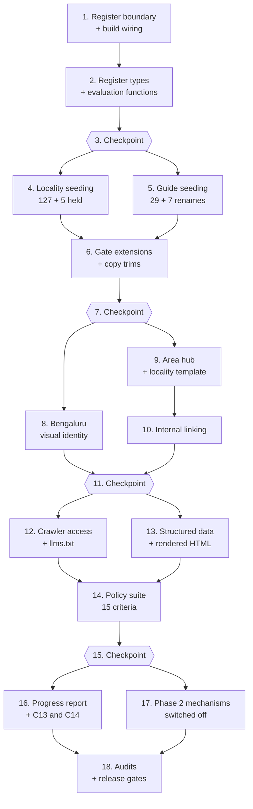

# Implementation Plan: SEO Content and Bengaluru Identity

## Overview

The build order follows the design's rollout sequence. Phase 1 — tasks 1 to 16 — is everything deliverable with zero owner input: the internal register boundary, the typed registers and their pure evaluation functions, 127 seeded locality candidates and 29 seeded guide candidates, the additive gate conditions, the inline-SVG Bengaluru identity, the area hub at a hundred-plus links, internal linking, per-agent crawler access, the structured-data correction, the fifteen Requirement 12 policy criteria, the sixteen correctness properties and the honest progress report. Phase 2 — task 17 — builds the owner-blocked mechanisms as code and leaves them switched off, each naming the checklist ID that unblocks it. Task 18 runs the real gates.

Nothing in this plan lowers an existing gate. Every gate change is an additional failure condition, so the publishable count can only move on evidence. Where a task changes a count, the task says which count and why.

Constraints every task inherits: canonical brand exactly `INSTLE REAL ESTATE`; telephone link exactly `tel:9353096264`; owner `Utpal Raj KB`; domain unconfirmed, so no canonical tag, no absolute URL, no served sitemap; no listings, prices, availability, valuations, reviews, ratings, fabricated counts or timed guarantees; no generated property, person or office imagery; WCAG 2.2 AA contrast arithmetic; 170 KB compressed homepage script budget; zero horizontal overflow from 320 to 1440 px and at 150% text; system fonts only.

## Tasks

- [x] 1. Establish the internal register boundary and the build wiring
  - [x] 1.1 Create the `internal/registers/` directory outside the app module graph
    - Add `internal/registers/` at the repository root with typed module stubs for `search-intent.ts`, `observation.ts`, `batches.ts`, `withdrawals.ts`, `postcode-pairs.ts`, `entity-boundary-decisions.ts` and `excluded-methods.ts`
    - Add the `@internal/*` → `internal/*` alias to `vitest.config.ts` and to the `paths` block in `tsconfig.json` so `tsc --noEmit` resolves test and script imports; leave `next.config.ts` compiling from `src/app` only
    - Extend the vitest `include` globs to cover `tests/properties/**/*.test.ts`
    - _Requirements: 3.12, 7.8_

  - [x] 1.2 Add the structural unreachability assertions
    - Assert no file under `src/` contains the substring `@internal` or a relative path segment reaching `internal/`
    - Assert no `internal/registers/` module appears in the transitive import closure of any registered public route, and that no register entry identifier appears in any server-rendered public route or in the sitemap output
    - _Requirements: 3.12, 7.8, 12.10_

  - [x] 1.3 Add the property-based testing dependency and the shared generators
    - Add `fast-check` as a dev dependency pinned to the exact version `4.10.2` with no range prefix
    - Create `tests/properties/arbitraries.ts` with `arbIsoDate`, `arbSlug`, `arbSourceRecord` and `arbClaimRecord`; later tasks extend this file with the record, asset, route and environment generators they need
    - Configure every property test to run at a minimum of 100 iterations via `fc.assert(..., { numRuns: 100 })`
    - _Requirements: 12.13_

  - [x] 1.4 Wire the policy suite ahead of the build
    - Add `"prebuild": "vitest run --reporter=dot"` to `package.json` so npm runs it before `build` and `next build` never starts after a failing assertion
    - Confirm the non-zero exit behaviour with a scratch failing assertion, then remove the scratch assertion; leave `next dev` untouched
    - _Requirements: 12.13, 12.14_

- [x] 2. Build the internal register types and their pure evaluation functions
  - [x] 2.1 Implement the search intent register
    - Write `PhraseSource`, `LocationContext`, `VolumeObservation`, `VolumeAvailability`, `SearchIntentEntry` and `CompetitorObservation` exactly as the design defines them, `readonly` throughout, with `null` meaning not supplied
    - Implement `evaluateIntentEntry` returning every missing field by name, and `evaluateVolume` returning unavailable with a reason when the volume is absent, when any of the tool name, query date, location setting, language setting or date range is empty, or when the re-query date has passed — with no rounding branch and no inference branch
    - Record superlative broker phrases as research queries only, and label every recorded competitor position a dated sample
    - _Requirements: 3.1, 3.2, 3.3, 3.8, 3.9, 3.10, 3.13, 3.15_

  - [x] 2.2 Implement one-question-one-page intent assignment
    - Add `assignPrimaryIntent` rejecting a second assignment of an already-served intent, returning the conflicting route and leaving the second record unpublished
    - Enforce at most one primary intent per route and at most five supporting phrases per page
    - _Requirements: 3.4, 3.5, 3.14_

  - [x]* 2.3 Write unit tests for the search intent register
    - Entry validity matrix across every required field; volume availability either side of the 180-day boundary; manual-method-only mode with every volume unavailable
    - _Requirements: 3.1, 3.2, 3.3, 3.13, 3.15_

  - [x] 2.4 Implement the observation register and seed the benchmark questions
    - Write `ObservationTool`, `BenchmarkQuestion`, `Determined<T>`, `Applicability<T>`, `ObservationEntry`, `ObservationCorrection` and `SamplingRound`
    - Seed the ten benchmark questions OBS-Q01 to OBS-Q10 with the design's initial `reportable` flags and exclusion reasons: OBS-Q05 blocked on checklist C1, OBS-Q08 blocked because no locality passes the gate, OBS-Q09 blocked on checklist C4; make OBS-Q05 and OBS-Q08 become reportable from the condition rather than from a placeholder area name
    - Implement round validation (one entry per reportable question per tool), the 30-day interval, the at-most-2-day round window, five-working-day correction arithmetic and Google Maps recorded not-applicable with a reason while no Maps presence is confirmed
    - Recording stays switched off until the domain is confirmed under checklist A1; the register compiles and validates with zero entries
    - _Requirements: 7.1, 7.2, 7.3, 7.4, 7.6, 7.7, 7.9, 7.10, 7.11_

  - [x]* 2.5 Write unit tests for the observation register
    - The ten questions and their exclusion reasons; round completeness and cardinality; the 30-day interval and 2-day window at their boundaries; five-working-day correction arithmetic from every weekday start; Maps not-applicable handling
    - _Requirements: 7.1, 7.3, 7.6, 7.7, 7.10_

  - [x]* 2.6 Write property test for unevidenced values
    - **Property 8: A value that cannot be evidenced is recorded unavailable with a reason, never substituted**
    - **Validates: Requirements 3.2, 3.3, 3.15, 7.11, 13.10**

  - [x] 2.7 Implement the derived workflow state module
    - Create `src/config/editorial-workflow.ts` with `WorkflowState`, `WORKFLOW_SEQUENCE`, `deriveWorkflowState`, `transition` (forward one step, back any number of steps, everything else rejected with an error naming the transition), `validateApprovalSignOff` (three distinct attributable names, `NON_ATTRIBUTABLE_REVIEWER_NAMES` reused from `claims.ts`, timestamp ordering local ≤ editorial ≤ SEO) and `validateBatch` (8 to 12 for the first batch, 10 to 15 later, every member passing the gate, three distinct reviewers, no partial release)
    - Derive the eight states from the existing `editorialStatus` and `publicationStatus` rather than changing either type
    - Enforce the `sourceCheckedAt` / `contentUpdatedAt` / `nextReviewAt` recording rule, with `nextReviewAt` no earlier than `sourceCheckedAt` and no more than 180 days after it
    - _Requirements: 1.8, 11.1, 11.2, 11.3, 11.5, 11.11_

  - [x]* 2.8 Write unit tests for the editorial workflow
    - All 64 state-transition pairs; sign-off distinctness against padded and case-varied near-duplicates and against desk names; timestamp ordering; `validateBatch` sizing bands at their boundaries
    - _Requirements: 11.1, 11.2, 11.3, 11.11, 1.8_

  - [x] 2.9 Implement the media register and asset evaluation
    - Create `src/config/media-register.ts` with `MediaProvenance`, `PersonRelease`, `VisualAssetBase`, `IllustrationAsset`, `MapAsset`, `TextureAsset`, `PhotographAsset` and `VisualAssetRecord`, keeping `showsCommuteTimes` and `showsDistances` as literal `false` so a map asserting either will not compile
    - Implement `evaluateAsset` returning every missing provenance value by name, requiring a person release for any recognisable face, requiring alt text of 1 to 125 characters unless the asset is recorded decorative, and failing an expired licence or release
    - _Requirements: 9.13, 9.16, 10.1, 10.2, 10.3, 10.4, 10.11_

  - [x]* 2.10 Write unit tests for the media register
    - Provenance completeness matrix; person-release requirement; decorative alt handling; the literal-false map constraints; licence and release expiry at the boundary
    - _Requirements: 9.13, 9.16, 10.1, 10.2, 10.3, 10.11_

  - [x] 2.11 Implement the remaining internal registers
    - `batches.ts` with `ContentBatch`; `withdrawals.ts` with `WithdrawalEntry` carrying every gate failure string rather than a summary; `postcode-pairs.ts` with `PostcodePair` requiring at least two sources from at least two independence groups, a boundary version and a named reviewer, never rendered; `entity-boundary-decisions.ts` for held-out candidates; `excluded-methods.ts` with one entry per excluded method — purchased ranking links, private blog networks, comment placements, paid directory profiles, incentivised reviews and synthetic reviews — each carrying a reason and a recorded date
    - _Requirements: 1.15, 11.9, 11.10, 12.4, 12.11_

  - [x]* 2.12 Write property test for record field completeness
    - **Property 9: A record is usable only when every field its type requires is present, and the failure names each absent field**
    - **Validates: Requirements 3.1, 3.8, 3.13, 7.2, 8.11, 9.1, 9.13, 9.14, 9.16, 10.1, 10.2, 10.3, 12.4**

- [x] 3. Checkpoint - Ensure all tests pass
  - Ensure all tests pass, ask the user if questions arise.

- [x] 4. Seed the 132 locality candidates into typed records
  - [x] 4.1 Write the locality seeding script
    - Create `scripts/seed-locality-candidates.mjs` reading `docs/seo-launch-handoff/AREA-RESEARCH-BACKLOG.csv` with the design's column mapping: `candidate_id` → `entityId` as `LOC-BLR-<id>`, `candidate_name` → `canonicalName` verbatim, `candidate_slug` → `slug`, `entity_type_provisional` mapped with `junction-area` and `outer-place` becoming `micro-locality` with the original value preserved in a blocking note, `research_group_not_official_zone` → `marketingGroup` with the research-group suffix stripped so no group label can carry a boundary term, `unique_research_question` → the first blocking note
    - Implement the collision algorithm in CSV order: hold out a candidate whose slug is an alias key, matches an existing record's slug, matches an already-seeded slug, or whose canonical name matches an existing record's name or alias
    - _Requirements: 1.1, 1.2, 1.15_

  - [x] 4.2 Generate the registry files and record the held-out candidates
    - Emit typed records into `src/config/locality-registry/`, split by research group, and compose them into `LOCALITY_REGISTRY` alongside the five existing records
    - Seed every record with `actualServiceCoverage: 'unconfirmed'`, `coverageResponsibleOwner: null`, `editorialStatus: 'candidate'`, `publicationStatus: 'unpublished'` and an explicit null or empty collection in every other field — no plausible-looking defaults
    - Write the five held-out candidates — `AREA-016` sadashivanagar, `AREA-053` indiranagar and `AREA-077` koramangala colliding with existing registry slugs, plus `AREA-021` hebbal and `AREA-055` whitefield overlapping the preserved `north-bengaluru` and `whitefield-inner-enclaves` entities — into `internal/registers/entity-boundary-decisions.ts` with the colliding slug, both candidate identifiers and the question to be answered
    - Assert the accounting: 127 seeded plus 5 held plus 5 existing equals the 132 CSV candidates, and `north-bengaluru` is preserved untouched while D-IMPL-06 stays open
    - _Requirements: 1.1, 1.2, 1.10, 1.15_

  - [x] 4.3 Add the three absent locality record fields
    - Add `primaryIntent`, `supportingPhrases` and `visualAssetIds` to `LocalityRecord`, defaulting to `null` and empty arrays on every record, retaining `imageRightsRecords` unchanged
    - Copy the approved phrase text onto the record at approval so a page never reads the internal register, and add a test importing both sides to assert every record phrase traces to a register entry
    - _Requirements: 3.6, 9.2_

  - [x]* 4.4 Write property test for candidate seeding
    - **Property 6: Seeding a candidate list preserves identity and accounts for every input**
    - **Validates: Requirements 1.1, 1.2, 1.15, 4.1, 4.2**

  - [x]* 4.5 Write property test for slug resolution
    - **Property 5: Slug resolution is idempotent and canonical-fixed**
    - **Validates: Requirements 1.11**

- [x] 5. Seed the 36 guide candidates, renaming the seven permutation slugs
  - [x] 5.1 Implement guide classification and slug distinctness
    - Create `src/config/guide-classification.ts` with `EXTERNAL_FACT_LEXICON` and `classifyGuideContent`, so the content class is computed from the record's own text rather than hand-labelled
    - Implement `slugsDifferOnlyByPermutationToken` over hyphen-separated tokens with `INTENT_TOKENS`, `TYPE_TOKENS` and `AREA_TOKENS`, where `AREA_TOKENS` is derived from every locality canonical name and alias plus `bengaluru` and `bangalore`
    - _Requirements: 4.9, 4.11_

  - [x] 5.2 Write the guide seeding script and apply the seven renames
    - Create `scripts/seed-guide-candidates.mjs` reading the `guide`-family rows of `docs/seo-launch-handoff/ROUTE-MANIFEST.csv`, mapping `path` to the slug, `primary_user_intent` to the customer intent and `proposed_title` to the working title
    - Apply the seven renames the design records, because each manifest slug differs from a sibling only by an intent or property-type word: `sell-flat-bengaluru` → `what-happens-when-you-list-a-flat-for-sale`, `buy-flat-bengaluru` → `what-to-check-before-you-agree-to-buy-a-flat`, `rent-home-bengaluru` → `how-a-rental-search-actually-proceeds`, `rent-out-flat-bengaluru` → `what-a-landlord-decides-before-listing`, `buy-villa-checklist` → `questions-a-villa-purchase-raises`, `buy-site-plot-checklist` → `questions-a-site-purchase-raises`, `independent-house-checklist` → `questions-an-independent-house-purchase-raises`
    - Seed the 29 new records unpublished with empty `sections`, an empty `directAnswer` and `contentUpdatedAt: null` alongside the seven existing records, so every candidate is held out of every public surface from the moment it exists, and run the distinctness check over the seeded slugs
    - Record the whole-segment reading that permits `pin-code-locality-difference` as a named constant with its reasoning, and seed that record so it explains the concept without presenting any six-digit numeral as a PIN code
    - _Requirements: 4.1, 4.2, 4.6, 4.9, 12.3_

  - [x] 5.3 Add the absent guide record fields
    - Add `maintenanceOwner`, `nextReviewAt`, `primaryIntent`, `supportingPhrases` and `visualAssetIds` to `GuideRecord`, and `headingIntentEntryId` to `GuideSection`
    - _Requirements: 3.6, 4.10, 5.4_

  - [x] 5.4 Record the owner-blocked guide records
    - Store blocking notes naming the checklist entry for each blocked record: the eleven external-fact records the classifier identifies on C3, the commercial records on C4, the brokerage-fee record on C5, and `honest-customer-review` on C11 — seeded as a record describing how a review would be sourced, never as a review page
    - Write the `rera-verification-questions` copy around the existing `RERA registered|registration|approved` ban without adding a denial-list entry
    - _Requirements: 4.7, 12.6_

  - [x]* 5.5 Write property test for one question, one page
    - **Property 10: One question is served by exactly one page**
    - **Validates: Requirements 3.4, 3.5, 3.14, 4.9**

- [x] 6. Extend the publication gates and trim the over-long guide answers
  - [x] 6.1 Add the boundary version condition to the locality gate
    - Extend `evaluateLocality` so an administrative mapping naming no claim, or recording no `boundaryVersion`, fails the record rather than rendering a bare ward number, with a failure string naming the mapping type
    - _Requirements: 1.7, 1.14_

  - [x] 6.2 Add the new guide gate conditions
    - Implement the shared `countWords` and extend `evaluateGuide` to fail on: a direct answer outside 20 to 60 words; fewer than two sections; a heading not ending in a question mark or over 15 words; a heading with no `headingIntentEntryId`; a null, over-12-month or passed `nextReviewAt`; a null or non-attributable `maintenanceOwner`; an empty next step or scope note; a stored `own-process` class the classifier contradicts; an external-body figure with no gate-passing claim
    - Keep own-process records publishable attributed to the business with no named author and no `Article` structured data
    - _Requirements: 4.4, 4.5, 4.8, 4.10, 4.11, 4.12, 4.13, 5.3, 5.4, 5.11_

  - [x] 6.3 Trim the two over-long direct answers and rephrase the headings
    - Edit the copy of the published guides whose direct answers exceed 60 words so each lands inside 20 to 60 words, and rephrase every section heading on the three published guides as a question of at most 15 words ending in a question mark, taken from a recorded register phrase
    - This is a copy edit, not a gate exemption; the passing guide count returns to three within this task
    - _Requirements: 4.5, 4.12, 5.3, 5.4, 5.11_

  - [x] 6.4 Implement region hub evaluation and section duplication detection
    - Implement `evaluateRegionHub` requiring at least three published locality links and at least two sections whose text appears on none of the localities it links to
    - Implement `findDuplicateSections` comparing normalised whitespace and case both verbatim and after canonical-name substitution, enforcing at least two sections of at least 120 words, and use the one implementation for both the locality and region hub rules
    - _Requirements: 1.5, 2.7, 2.9_

  - [x] 6.5 Implement withdrawal propagation and the agreement assertion
    - Write `scripts/sync-publication-status.mjs` flipping `publicationStatus` to `unpublished` for every record the runtime gate now rejects, and writing a withdrawal entry carrying the record identifier, every gate failure string, the withdrawal date and every route removed, retaining the record and its approvals
    - Return a record to fact review when `contentUpdatedAt` is later than any of its three approvals
    - Assert the persisted status and the runtime gate never disagree: for every record, `publicationStatus === 'published'` implies the gate admits it
    - _Requirements: 1.12, 4.13, 11.6, 11.7, 11.9, 11.12_

  - [x]* 6.6 Write unit tests for the new gate conditions
    - The boundary version condition; `evaluateRegionHub` thresholds; `findDuplicateSections` including the place-name-substituted case; `classifyGuideContent` over the external-fact candidates; the four owner-blocked slugs against their checklist entries
    - _Requirements: 1.5, 1.14, 2.7, 4.7, 4.11_

  - [x]* 6.7 Write property test for gate monotonicity
    - **Property 3: The publication gate is monotonic in evidence**
    - **Validates: Requirements 1.2, 1.13, 1.14, 4.3, 11.4**

  - [x]* 6.8 Write property test for the staleness cascade
    - **Property 4: Stale evidence withdraws dependent content automatically**
    - **Validates: Requirements 1.12, 4.13, 10.11, 11.6, 11.7, 11.9, 11.12**

- [x] 7. Checkpoint - Ensure all tests pass
  - Ensure all tests pass, ask the user if questions arise.

- [x] 8. Build the Bengaluru visual identity with zero photography
  - [x] 8.1 Write the five inline SVG server components
    - Create `src/components/Bengaluru/` with `CivicStreetscapeBand`, `CorridorDiagram`, `LayoutGridMotif`, `AreaOrientationPlate` and `TypographicPlate`, each a server component returning inline `<svg>` composed from hand-written `path`, `rect` and `circle` primitives using `currentColor` and token custom properties
    - Keep every subject generic: no nameboard, house number, shop name, registration plate or signage text; no human figure or face; no recognisable landmark; no external host and no animation
    - _Requirements: 9.1, 9.2, 9.3, 9.4, 9.11, 9.15_

  - [x] 8.2 Record the assets in the Media_Register
    - Add the `ILL-STREETSCAPE-001`, `ILL-STREETSCAPE-002`, `MAP-CORRIDOR-001`, `MAP-AREA-<slug>` and texture entries with full provenance, generic `depicts` nouns checked against a generic-subject lexicon, the visible illustration and orientation-aid labels, `backgroundColoursBehindText` listing every colour presented behind text, and measured `compressedBytes`
    - Update the provenance table in `docs/implementation/DESIGN-AND-MEDIA.md` part 2 to match, and populate `visualAssetIds` on the records that render each asset
    - _Requirements: 9.2, 9.13, 9.16, 9.17_

  - [x] 8.3 Wire the elements into the pages that must carry one
    - Render `CivicStreetscapeBand` on the homepage and the cropped variant on `/buy`, `/sell`, `/rent`, `/rent-out` and `/commercial`; `CorridorDiagram` on `/areas`; `AreaOrientationPlate` on the published locality template
    - Render the visible text labelling each map an orientation aid and each illustration an illustration, omit every commute time and distance, and draw a boundary only from a gate-passing claim
    - Fall back to `TypographicPlate` alone where no illustration or map applies, with no placeholder image, no empty frame and no substitute graphic
    - _Requirements: 9.2, 9.3, 9.4, 9.15, 9.16_

  - [x] 8.4 Extend the token test to asset background colours
    - Compute 4.5:1 for each page's text colour against every colour an asset declares behind text, and 3:1 for non-text pairings, from the real source values
    - Assert every `fill` and `stroke` literal in each Bengaluru component appears in the asset's declared colour list or in `tokens.css`
    - _Requirements: 9.5_

  - [x] 8.5 Add the asset policy assertions
    - Assert no file under `src/components/Bengaluru/` contains `<image`, `xlink:href`, `href="http`, `<animate`, `<animateTransform` or `<set`, so the identity introduces no external request and nothing to suppress under reduced motion
    - Assert no public page references a generated or AI-created portrait, office image, transaction scene, customer image or property image
    - _Requirements: 9.9, 9.11, 9.14_

  - [x] 8.6 Add the Indian English term policy
    - Create `src/config/indian-english-terms.ts` with `PRIMARY_TERMS` and `PROSCRIBED_TERMS` as the design lists them, each proscribed entry naming its replacement, and scan every public page's copy against it
    - _Requirements: 9.12_

  - [x] 8.7 Write the asset weight measurement script
    - Create `scripts/measure-visual-assets.mjs` serialising and gzipping each component's markup, reporting per-asset weight against 80 KB and per-route weight against 150 KB, writing JSON alongside the existing audit output
    - _Requirements: 9.17_

- [x] 9. Scale the area hub and the locality page template
  - [x] 9.1 Implement deterministic grouping
    - Create `src/lib/locality-grouping.ts` with `orderingKey`, `compareByName` as a total order over code points rather than locale collation, `MAX_VISIBLE_LINKS_PER_GROUP = 25`, `LocalityGroup`, `LocalityLink` and `groupPublishedLocalities` dropping empty groups and splitting each group at 25
    - Add the sibling helper that groups published guides by customer intent using the same comparator and the same split
    - _Requirements: 2.2, 2.3, 2.6_

  - [x] 9.2 Render the area hub at scale
    - Render one heading per non-empty `marketingGroup`, exactly one crawlable text link per canonical published slug with the locality name as the link text, the `BROWSING_AID_NOTE` beside every heading, and the overflow links inside a native `<details>` element in the same server-rendered response so no group shows more than 25 links and no link needs JavaScript
    - Keep the empty state at HTTP 200 naming all four publication conditions while zero records pass the gate
    - Keep `marketingGroup` out of page metadata and out of structured data
    - _Requirements: 1.6, 2.1, 2.2, 2.3, 2.4, 2.5, 2.6_

  - [x] 9.3 Harden the locality page template
    - Render at least two sections, the administrative value and its boundary version in the same element, and resolve an alias slug to its canonical slug before evaluating the gate
    - Return 404 with a "Page not found" title carrying `noindex` for an unknown slug, a gate-failing record and an alias whose canonical fails the gate, leaking no summary, section, FAQ, mapping or blocking note text
    - Read visibility only from the gate called with the request date, in the page, `generateStaticParams`, `generateMetadata` and the sitemap
    - _Requirements: 1.3, 1.4, 1.5, 1.7, 1.11, 2.5_

  - [x] 9.4 Gate the region hub route
    - Return 404 and exclude the route from links, static params and the sitemap while it links to fewer than three published localities or carries fewer than two unique sections
    - _Requirements: 2.7, 2.9_

  - [x]* 9.5 Write property test for hub grouping
    - **Property 7: Hub grouping partitions the published set deterministically and caps every visible group at 25**
    - **Validates: Requirements 2.2, 2.3, 2.4, 2.6**

  - [x]* 9.6 Write property test for gate-failing records leaking nothing
    - **Property 1: A gate-failing record contributes nothing to any public surface**
    - **Validates: Requirements 1.4, 1.11, 2.5, 4.6, 8.4, 8.5, 11.6, 11.8**

- [x] 10. Build the internal link system
  - [x] 10.1 Implement the link groups and their rules
    - Render the three server-rendered groups — relevant service pages, gate-passing related guides, gate-passing nearby localities — with 1 to 6 links whenever a qualifying destination exists, omitting the heading and container entirely when none does
    - Render the claim-backed relationship statement inside the same list item as each nearby link, and omit a nearby candidate with no gate-passing relationship claim without leaving a placeholder, partial sentence or disabled link
    - Enforce link text of 2 to 80 characters naming the destination subject, reject the generic set and bare URLs case-insensitively, place 1 to 3 call actions per content page, and cap the footer at 12 links drawn from the header sections plus one call action with no individual locality or guide link
    - _Requirements: 8.1, 8.2, 8.4, 8.5, 8.6, 8.7, 8.9, 8.11_

  - [x] 10.2 Add the build-time link integrity checks
    - Fail the build naming the source page and destination route when a destination fails the gate or does not return HTTP 200 during the build
    - Fail the build when a page's server-rendered HTML carries more than 60 internal links counted across header, main and footer with repeats counted separately, or when superlative-plus-brokerage anchor text appears on more than one page
    - _Requirements: 8.3, 8.5, 8.8, 8.10_

  - [x]* 10.3 Write property test for surface and gate agreement
    - **Property 2: Every gate-passing record is present on every surface that lists it**
    - **Validates: Requirements 1.3, 1.9, 2.2, 2.6, 8.5, 8.10, 13.1**

- [x] 11. Checkpoint - Ensure all tests pass
  - Ensure all tests pass, ask the user if questions arise.

- [x] 12. Configure crawler access and llms.txt
  - [x] 12.1 Implement the crawler access register
    - Create `src/config/crawler-access.ts` with `AccessDecision`, `CrawlerAccessDecision`, the two separate exported constants `SEARCH_CRAWL_DECISION` for `OAI-SearchBot` and `TRAINING_CRAWL_DECISION` for `GPTBot`, and `buildAgentGroup` resolving anything other than `allowed` — including `unrecorded` — to `Disallow: /`
    - Seed the training decision as `unrecorded` so training access is never granted by default, and record each decision's deciding person, decision date, guidance reference, verification date and verifying person
    - Fail the policy suite when a recorded verification date is more than 90 days before the build date
    - _Requirements: 6.3, 6.4, 6.5, 6.10, 6.11_

  - [x] 12.2 Rewrite the robots route
    - Make `src/app/robots.ts` force-dynamic, serving a single `User-agent: *` group with `Disallow: /`, no `Allow` line and no sitemap reference unless the deploy environment is exactly `production` and the domain is confirmed; then serving the wildcard group allowing gate-passing routes, disallowing `/api/`, plus the two per-agent groups from their own builder calls
    - Assert every enquiry API response keeps `Cache-Control: no-store` and `X-Robots-Tag: noindex, nofollow` on success, validation-failure and server-error paths
    - Assert no registered page route carrying `noindex` is covered by any `Disallow` pattern, with the page-route scoping decision recorded as a named constant beside the assertion
    - _Requirements: 6.1, 6.2, 6.6, 6.7_

  - [x] 12.3 Add the llms.txt route
    - Create `src/app/llms.txt/route.ts`, force-dynamic, returning 404 unless the environment is production and the domain is confirmed, generating every line from published records and the shared brand and phone constants
    - Assert every non-heading line's text is a substring of some gate-passing page's visible text and every URL corresponds to a gate-passing route
    - _Requirements: 6.9, 6.12_

  - [x]* 12.4 Write unit tests for crawler access
    - Byte-compare the emitted group of each decision after mutating the other to prove independence; the 90-day verification boundary; the `noindex`-under-`Disallow` scoping decision
    - _Requirements: 6.3, 6.6, 6.11_

  - [x]* 12.5 Write property test for crawler access
    - **Property 15: Crawler access fails closed, and the two crawler decisions are independent**
    - **Validates: Requirements 6.1, 6.2, 6.3, 6.6, 6.10, 6.11**

- [x] 13. Correct the structured data and prove the rendered HTML
  - [x] 13.1 Implement the structured data policy module
    - Create `src/lib/structured-data-policy.ts` with `PERMITTED_TYPES`, the short `STRUCTURAL_VALUE_KEYS` allowlist for schema vocabulary values, `FORBIDDEN_KEYS` and `auditGraph` returning every failure by name
    - Assert the allowlist stays short and explicit, and that no graph value carries a hostname while the domain is unconfirmed
    - _Requirements: 5.6, 5.7, 5.8, 5.13_

  - [x] 13.2 Fix the Organization node and add per-page Service nodes
    - Remove the `description` from `buildOrganisationNode`, because that sentence appears in no visible text on the homepage and Requirement 5.6 permits a property value only when a reader can see the same value
    - Add a `Service` node on each service page whose `name` and `description` are taken verbatim from that page's visible heading and lead, keeping `contactPoint.contactType` and `availableLanguage` as exempt vocabulary
    - Keep own-process guides free of `Article` structured data
    - _Requirements: 4.4, 5.6, 5.7_

  - [x] 13.3 Add the direct answer component
    - Create `GuideDirectAnswer` rendering the answer as the first text block after the `<h1>` and before the first section heading, carrying an inert `data-direct-answer` attribute so the position can be asserted on real markup rather than guessed from class names
    - _Requirements: 5.3, 5.11_

  - [x] 13.4 Write the rendered HTML proof
    - Create `tests/rendered-html.test.tsx` asserting, for every registered public route, that the static markup carries the canonical brand, the exact telephone link, exactly one `<h1>`, every section heading and every body paragraph held in the record, so content that exists in data but is never rendered fails the build
    - Assert the direct answer's document position, that every emitted JSON-LD string value appears in the page's visible text after normalisation, and that no brand or telephone rendering differs by a single character
    - _Requirements: 1.6, 5.1, 5.2, 5.5, 5.12_

  - [x]* 13.5 Write property test for structured data
    - **Property 14: Structured data emits only permitted types and only values a reader can see**
    - **Validates: Requirements 1.6, 4.4, 5.6, 5.7, 5.8, 5.13**

- [x] 14. Extend the content policy test suite to all fifteen Requirement 12 criteria
  - [x] 14.1 Add route shape scanning
    - Create `tests/helpers/route-shape.ts` with `RegisteredRoute` and `enumerateRegisteredRoutes` walking `src/app` for `page.tsx`, and assert no named doorway path, no dynamic segment directly beneath a transaction-intent or property-type segment, and no route with two or more dynamic segments — naming the offending path in each case
    - _Requirements: 12.1_

  - [x] 14.2 Add slug and PIN code scanning
    - Assert every resolvable `/areas/` slug is the exact slug of exactly one record, and that no slug carries an intent word, a type word or a six-digit numeric group, running over every registry slug plus every alias key
    - Apply whole-segment equality for `pin`, `pin-code`, `pincode`, `pincodes`, `postcode` and `postal-code` plus any six-digit numeric segment, with the recorded decision constant naming `pin-code-locality-difference` as the case it protects, and scan copy for a six-digit numeral presented as a PIN code within 40 characters of a PIN or postcode term
    - _Requirements: 12.2, 12.3_

  - [x] 14.3 Make the approved-denial list accountable
    - Replace the flat `APPROVED_DENIALS` strings with the typed `ApprovedDenial` carrying the exact fragment, the reason the occurrence is a denial rather than a use, and the criterion it relates to
    - Add the dead-denial assertion: every entry must still match at least one file on the public surface, so a rewritten fragment fails and gets removed rather than quietly widening the amnesty
    - _Requirements: 12.6, 12.7_

  - [x] 14.4 Derive the scan coverage floor
    - Implement `computePublicSurfaceClosure` starting from the `page.tsx`, `layout.tsx` and `route.ts` files of registered routes and following `@/` and relative imports transitively, excluding prototypes and components no registered route imports
    - Replace the fixed file-count assertion with the derived floor, reporting the scanned count, the expected count and each missing file
    - _Requirements: 12.13, 12.15_

  - [x] 14.5 Extend the copy scans
    - Add per-property component detection for a repeated element carrying two or more of price, area, bedroom count or location, plus property lists and valuation offers; the coverage cross-reference failing an assertion of service in an area whose `actualServiceCoverage` is not confirmed; the AI-addressed text scan across visible text, hidden text, attribute values and code comments; the superlative self-description scan; the browsing-label boundary-term scan; the photograph caption term scan; and the observation-presented-as-ranking scan
    - Keep the existing brand, telephone, WhatsApp and absolute-URL invariants passing unchanged
    - _Requirements: 2.8, 3.11, 5.10, 7.5, 10.10, 12.5, 12.6, 12.7, 12.8, 12.9_

  - [x] 14.6 Add the fixture and unpublished record import scan
    - Fail the build naming the importing file and the imported module when a module rendering a registered public route imports a synthetic review, lead or locality fixture, or reaches `LOCALITY_REGISTRY` or `GUIDE_REGISTRY` directly instead of the gated accessors
    - _Requirements: 12.10_

  - [x]* 14.7 Write property test for banned pattern detection
    - **Property 11: A banned pattern anywhere on the public surface is detected and reported, and is exempt only when explicitly denial-listed**
    - **Validates: Requirements 2.8, 3.11, 5.5, 5.10, 5.12, 5.13, 7.5, 8.3, 9.12, 10.10, 12.5, 12.6, 12.7, 12.8, 12.9**

  - [x]* 14.8 Write property test for route and slug shape
    - **Property 12: Route and slug shapes that constitute a doorway pattern are rejected**
    - **Validates: Requirements 12.1, 12.2, 12.3**

  - [x]* 14.9 Write property test for scan coverage
    - **Property 13: The policy scan covers the whole public surface, and a shrunken scan cannot pass**
    - **Validates: Requirements 12.13, 12.15**

- [x] 15. Checkpoint - Ensure all tests pass
  - Ensure all tests pass, ask the user if questions arise.

- [x] 16. Generate the honest progress report and add the two owner register entries
  - [x] 16.1 Write the progress report generator
    - Create `scripts/generate-progress-report.mjs` computing, from the gate rather than from any stored flag, the published locality count, the published guide count and their labelled sum; the count in each of the eight workflow states partitioning all 168 candidates; the remaining-to-100 figure clamped at zero; per-record failure lists carrying every reason the gate returns; per-checklist-entry blocked counts referencing the register as the only place the request wording lives; released batches with their identifiers, dates and three named reviewers; and separately labelled static route counts outside the published page count
    - Write the output into `docs/implementation/STATUS.md` with the evaluation date, the dated statement that page count, structured data and crawler permission guarantee neither a ranking nor an AI citation, the statement that a crawler without live retrieval may not know the business and that no owner-controlled method updates a model's stored knowledge, and the note that observation recording has not begun because no public URL exists
    - Record any traffic, lead, conversion or volume figure as unmeasured with no source or date rather than as an estimate, and restate every count on a batch release, a withdrawal or a state change
    - _Requirements: 1.9, 5.9, 6.8, 11.10, 12.12, 13.1, 13.2, 13.3, 13.4, 13.5, 13.6, 13.7, 13.8, 13.9, 13.10_

  - [x]* 16.2 Write unit tests for the progress report arithmetic
    - Count arithmetic against the gate; the 168-candidate partition summing exactly; per-entry blocked counts; the clamped remaining-to-100 figure at and above 100
    - _Requirements: 13.1, 13.2, 13.4, 13.5_

  - [x] 16.3 Add checklist entries C13 and C14
    - Append C13 for the keyword research tool choice and licence, and C14 for the GPTBot training-crawl decision, to section C of `docs/implementation/OWNER-FACTS-CHECKLIST.md` using the design's wording, numbered after the existing C12
    - Add assertions that both entries exist, that the register is the only place the request wording appears, and that the progress report references them by identifier
    - _Requirements: 3.7, 6.4, 13.4_

- [x] 17. Build the owner-blocked mechanisms and leave them switched off
  - [x] 17.1 Build the photograph rendering pathway
    - Implement the photograph component honouring recorded intrinsic pixel dimensions, alt text of 1 to 125 characters or an empty alt where recorded decorative, at most 6 photographs and 500 KB per page, `priority` on at most one image, and a caption of at most 120 characters carrying only the area name and the date taken
    - Fail the build while a page references a photograph whose licence or release has expired, and keep the pathway inert because no photograph is recorded — blocked on checklist C12
    - _Requirements: 10.1, 10.2, 10.3, 10.4, 10.5, 10.6, 10.7, 10.10, 10.11_

  - [x] 17.2 Handle the owner portrait pathway
    - Render the portrait on `/about/utpal-raj-kb` with alt text naming Utpal Raj KB once a released portrait is recorded, and assert that no image element and no image placeholder renders while none is — blocked on checklist C7
    - _Requirements: 10.8, 10.9_

  - [x] 17.3 Build the coverage confirmation path
    - Implement the function that sets `actualServiceCoverage` to `confirmed-served` and `coverageResponsibleOwner` from a recorded register answer, keeping `publicationStatus` at `unpublished` until the three named reviewers have approved, and recording the blocking checklist entry while any reviewer name is unsupplied — blocked on checklist C1 and C2
    - _Requirements: 1.13, 11.4_

  - [x] 17.4 Build the preview surface for unpublished records
    - Add the preview route for inspecting a record that has not passed the gate, returning 404 in every production build and excluded from the sitemap and from every link on a public page
    - _Requirements: 11.8_

  - [x] 17.5 Build the observation reporting renderer
    - Render, from the observation register into the progress report, the sampling round identifier, the round date, the tool, the count of questions mentioned, the count sampled, and the statement that the figures are manual samples by one named observer in one location context; keep it inert with zero rounds recorded and state that recording awaits the domain — blocked on checklist A1
    - _Requirements: 7.9, 7.12_

  - [x]* 17.6 Write property test for the declared bounds
    - **Property 16: Every declared bound holds at every input size**
    - **Validates: Requirements 1.5, 1.8, 2.3, 2.7, 2.9, 3.6, 4.5, 4.10, 4.12, 5.3, 5.4, 5.11, 8.1, 8.2, 8.6, 8.7, 8.8, 8.9, 9.17, 10.5, 10.7, 11.5**

- [x] 18. Run the audits and the release gates
  - [x] 18.1 Extend the responsive audit
    - Generate the audit's page list from `getPublicRoutes()` so a newly published page is audited without editing an array, keep the existing overflow, single-`<h1>`, tap-target and action-bar checks across 320, 360, 390, 768, 1280 and 1440 px, and convert the 150% text pass at 320 px and 1280 px into a measured assertion rather than a screenshot
    - _Requirements: 9.7, 9.8, 9.10_

  - [x] 18.2 Run every gate and record the outcome
    - `npm run lint` — eslint reports zero errors and zero warnings
    - `npm run typecheck` — `tsc --noEmit` reports zero errors
    - `npm run test` — every unit, example and property test passes, with each property test running at least 100 iterations
    - `npm run build` — `prebuild` passes first, then `next build` succeeds and produces deployable output
    - `node scripts/responsive-audit.mjs` — zero findings across all six widths and at 150% text
    - `npm run measure:js` — homepage first-load scripts at or below 170 KB compressed, unchanged by this feature because every component added is a server component and `<details>` needs no script
    - `node scripts/measure-visual-assets.mjs` — every asset at or below 80 KB compressed and every route at or below 150 KB
    - Remove any temporary file created during verification
    - _Requirements: 9.6, 9.7, 9.8, 9.17, 12.13, 12.14_

## Notes

- Tasks marked with `*` are optional and can be skipped for a faster first pass; they are the unit, integration and property tests.
- Every task references the acceptance criteria it satisfies, so coverage is traceable in both directions.
- Phase 1 is tasks 1 to 16 and needs no owner input. At the end of it the published page count is still 12 static pages plus 3 guides — what changes is that 156 candidate records exist as typed, gated, accounted-for work and the build refuses to ship a doorway route, a leaked draft, an invisible schema value or an unevidenced ward number.
- Task 17 builds the owner-blocked mechanisms and leaves them off, each naming the checklist entry that unblocks it. No capability degrades into a guess.
- Three design decisions carry into the code and must not be quietly reversed: five locality candidates are held out rather than seeded (127 + 5 + 5 = 132); seven guide manifest slugs are renamed at seed time because Requirement 4.9 forbids slugs differing only by an intent or type word; and the `Organization.description` is dropped rather than exempted, because the description a machine reads must be the description a person reads.
- The guide gate extension in task 6.2 would drop the passing guide count from 3 to 1 on its own. Task 6.3 trims the copy in the same task group so the count returns to 3. No guide is exempted from the gate.

## Task Dependency Graph



Parallel opportunities: tasks 4 and 5 are independent seeding runs over different sources; task 8 touches only components, styles and the media register while task 9 touches the hub and locality surfaces; tasks 12 and 13 touch different route and library files. Everything downstream of a checkpoint waits for it.

```json
{
  "waves": [
    { "id": 0, "tasks": ["1.1", "1.3"] },
    { "id": 1, "tasks": ["1.2", "1.4", "2.1", "2.4", "2.9", "2.11"] },
    { "id": 2, "tasks": ["2.2", "2.3", "2.5", "2.7", "2.10", "2.12"] },
    { "id": 3, "tasks": ["2.6", "2.8", "4.1", "5.1"] },
    { "id": 4, "tasks": ["4.2", "5.2"] },
    { "id": 5, "tasks": ["4.3", "4.4", "4.5", "5.3", "5.4"] },
    { "id": 6, "tasks": ["5.5", "6.1", "6.2", "6.4"] },
    { "id": 7, "tasks": ["6.3", "6.5", "6.6", "6.7", "6.8"] },
    { "id": 8, "tasks": ["8.1", "8.6", "9.1"] },
    { "id": 9, "tasks": ["8.2", "8.4", "8.5", "9.2", "9.4"] },
    { "id": 10, "tasks": ["8.3", "8.7", "9.3", "9.5", "9.6"] },
    { "id": 11, "tasks": ["10.1", "12.1", "13.1"] },
    { "id": 12, "tasks": ["10.2", "10.3", "12.2", "12.3", "13.2", "13.3"] },
    { "id": 13, "tasks": ["12.4", "12.5", "13.4", "13.5", "14.1", "14.2"] },
    { "id": 14, "tasks": ["14.3", "14.4", "14.5", "14.6"] },
    { "id": 15, "tasks": ["14.7", "14.8", "14.9", "16.1", "17.1", "17.3", "17.4"] },
    { "id": 16, "tasks": ["16.2", "16.3", "17.2", "17.5", "18.1"] },
    { "id": 17, "tasks": ["17.6", "18.2"] }
  ]
}
```
