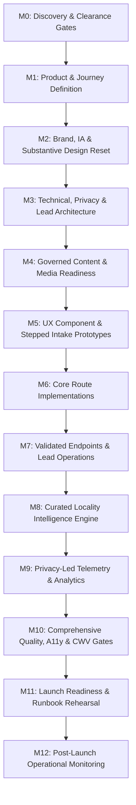

# INSTLE REAL ESTATE — CORRECTED DELIVERY ROADMAP & IMPLEMENTATION BLUEPRINT

**Document Date:** September 2026  
**Reference Baseline:** Commit `ca8737b` on branch `feature/milestone-1-scaffolding-and-shell`  
**Governing Documents:**
- `INSTLE-ANTIGRAVITY-RECOVERY-BRIEF.md` (Authority delivery correction)
- `INSTLE-REAL-ESTATE-BENGALURU-MASTER-BLUEPRINT.md` (Version 1.0 Master Blueprint)
- `AGENTS.md` (Strict project invariants and compliance guardrails)

---

## 1. Project Invariants & Non-Negotiables

| Invariant | Mandatory Specification | Prohibited / Out of Scope |
|---|---|---|
| **Canonical Brand** | **`INSTLE REAL ESTATE`** (exact spelling, all-caps lockup). Short reference: **`INSTLE`**. | `LUXERE`, `Luxere`, `Instle Real Estate` (mixed case in lockup), `Generic Real Estate`. |
| **Canonical Phone** | **`9353096264`**; visual display `9353096264`; link `href="tel:9353096264"`. | No WhatsApp assumptions, buttons, links, or icons. |
| **Domain Status** | **`TO BE CONFIRMED`**. `<link rel="canonical">` remains unset. | Do not hardcode assumed domain in metadata, Open Graph, or sitemaps. |
| **Truthfulness & Anti-Fabrication** | Real human brokerage advisory model only. No fake inventory, prices, availability, or customer statistics. | No public property listings, inventory cards, fake feeds, or automated valuation engines. |
| **Accessibility Standard** | **WCAG 2.2 AA** target across all breakpoints, forms, and dialogs. | Blanket claims of "WCAG AAA" or "flawless" accessibility without test evidence. |
| **Branch & Environment** | Work remains on `feature/milestone-1-scaffolding-and-shell`. | No direct commits to `main`; no unauthorized production deployment. |

---

## 2. Decision Register Alignment (Canonical Blueprint IDs)

The roadmap uses the actual Master Blueprint Decision and Task IDs:

| Blueprint ID | Domain & Scope | Current Status & Dependency | Roadmap Treatment |
|---|---|---|---|
| **D-01** | Legal entity / trading name relationship | Open (Counsel/Owner) | Verified before public `/about`, structured data, or formal legal notices. |
| **D-02** | INSTLE mark collision & trademark clearance | Open (Counsel) | Brand work proceeds with collision clearance gate before public trademark assertions. |
| **D-03** | Canonical Domain registration & URL | **DOMAIN: TO BE CONFIRMED** | Canonical tags remain omitted; sitemap generation deferred. |
| **D-04** | Phone `9353096264` business control & staffing | Open (Operations) | Preserved across all headers, footers, hero viewports, and sticky bars. |
| **D-05** | Authorized WhatsApp channel | Open (Owner) | Omitted completely from user-facing UI and navigation. |
| **D-06** | Service territory & asset classes | Open (Business) | Residential advisory first. Commercial services kept strictly conditional. |
| **D-07** | Fees, commission & representation disclosures | Open (Business + Counsel; Task **T-013**) | Form copy states advisory enquiry request; no unapproved fee claims. |
| **D-08** | Operational response time & SLA | Open (Operations) | Internal targets only; no false "immediate" or "guaranteed response" copy. |
| **D-09** | Existing CRM / lead inbox & queue owner | Open (Operations) | Synthetic adapter pattern in V1; durable persistence decoupled from provider. |
| **D-10** | CMS vs. Git-backed editorial content | Decided for V1: Git-backed | Structured TypeScript / JSON locality datasets with schema validation. |
| **D-11** | Hosting, regions, vendors & DPAs | Open (Tech + Counsel; Task **T-011**) | Next.js hybrid SSR; data minimisation architecture; no cross-border PII leakage. |
| **D-12** | Analytics & consent approach | Open (Privacy; Task **T-036**) | Minimal, privacy-first event contract (`form_start`, `form_submit`, `phone_click`); zero PII in telemetry. |
| **D-13** | Source languages & local Kannada naming | Open (Editorial) | Sourced locality aliases recorded; multilingual deferred to post-V1. |
| **D-14** | Commercial real estate pages inclusion | Conditional | Excluded from public navigation and consumer intake until capability verified. |
| **D-15** | Area maps requirement & licensing | Decided for V1: Editorial first | Curated locality profiles with transport/civic context; no heavy map bundles. |
| **D-16** | Public office address & hours | Open (Operations) | Held until customer-facing premises and business hours are verified. |
| **D-17** | Accountable privacy & grievance contact | Open (Counsel + Operations; Task **T-034**) | Privacy policy template ready for verified contact insertion upon counsel sign-off. |
| **D-18** | Typography licenses & font assets | Active in Design Reset | Self-hosted or Google Fonts web fonts with open licenses; Kannada script proof. |

---

## 3. Phased Implementation Roadmap (M0 through M12)

### Milestone Sequence & Dependencies

### Phase Breakdown & Acceptance Criteria

#### Phase 1: Substantive Design Reset (Section 2 — Current Focus)
- **Tasks:** T-021 (Brand Identity), T-022 (Wordmark), T-024 (Design Tokens & Typography), T-025 (Homepage Concepts A & B), T-041 (Responsive Navigation & Phone Access), T-042 (Buyer Intake Preview).
- **Deliverables:**
  1. **Concept 1: Architectural Dossier & Garden City Modernism** (Desktop & Mobile Homepage + Stepped Acquisition Brief).
  2. **Concept 2: Bengaluru Metropolitan Monolith** (Desktop & Mobile Homepage + Interactive Requirements Console).
  3. Interactive Concept Preview Switcher & Review Lab in the live application.
  4. Media Rights & Attribution Ledger.
  5. Side-by-side comparative analysis with formal architectural recommendation.
- **Exit Gate:** Owner reviews rendered concepts, selects preferred visual direction, and authorizes route rollout.

#### Phase 2: Core Route Implementation & Architecture (M5 & M6)
- **Tasks:** T-046 (Route Shell & Shared Layouts), T-047 (Service Pages: `/buy`, `/rent`, `/sell`, `/how-it-works`, `/contact`, `/about` holding shell).
- **Deliverables:**
  - Route-specific intent architectures:
    - `/buy`: Residential acquisition advisory with structured intake.
    - `/rent`: Prime residential tenant representation.
    - `/sell`: Owner representation and property intake (with landlord/rental toggle).
    - `/how-it-works`: Transparent 4-step brokerage methodology.
    - `/about`: Brand vision, ethical brokerage mandate (factual team sections held pending D-01/D-02 verification).
    - `/contact`: Direct phone access `9353096264`, enquiry routing, and service boundaries.
- **Exit Gate:** All core routes responsive, accessible (WCAG 2.2 AA), SSR-rendered, zero broken links, zero placeholder text.

#### Phase 3: Validated Intake Endpoints & Lead Operations (M7)
- **Tasks:** T-031 (Backend Architecture), T-032 (Lead Schema & Data Dictionary), T-033 (API Validation & Rate Limiting), T-048 (Server Endpoints), T-049 (Form State Integration), T-050 (Lead Operations Queue & Audit Trail).
- **Deliverables:**
  - Robust server action / API endpoint with schema validation (Zod/TypeScript).
  - Synthetic test fixtures simulating queue ingestion, dispositioning (`new`, `assigned`, `contact_attempted`, `qualified`, `closed_lost`), duplicate detection, and retention policy enforcement.
  - Client-side error states, keyboard focus restoration, network retry handling, and offline notice.
  - Zero PII stored in unreviewed local files or transmitted in client telemetry.
- **Exit Gate:** Automated test suite verifying validation failures, idempotency, rate limiting, and successful queue dispatch.

#### Phase 4: Curated Locality Intelligence Engine (M4 & M8)
- **Tasks:** T-018 (Locality Seed Registry), T-019 (Publication Gate & Template), T-038 (First Sourced Locality Records), T-051 (Areas Index & Guides).
- **Deliverables:**
  - Schema-backed locality records with dual-source validation (e.g., BBMP, BDA, Namma Metro Phase 2/3 operational timelines).
  - Editorial distinction between operational infrastructure and planned/proposed projects.
  - Initial curated set of high-interest Bengaluru micro-markets:
    - Indiranagar / Old Airport Road (Mature central-east corridor)
    - Koramangala / HSR Layout (South-east residential/tech hub)
    - Whitefield / Outer Ring Road (East enterprise and luxury apartment belt)
    - Sadashivanagar / Malleshwaram (Heritage North-Central established enclaves)
    - Hebbal / Bellary Road (North Bengaluru growth corridor)
  - Clear publication gate: unreviewed or thin draft localities remain unpublished and excluded from navigation/indexing.
- **Exit Gate:** Locality guides pass two-source claim gate and SEO review; zero doorway or generic template pages.

#### Phase 5: Privacy-Led Analytics, SEO & Legal Compliance (M3, M9 & M10)
- **Tasks:** T-034 (Privacy & Terms Documentation), T-036 (Analytics Event Map), T-040 (SEO Matrix & Structured Data), T-052 (Telemetry Implementation), T-053 (Accessibility Audit), T-054 (Core Web Vitals & Script Budget), T-055 (Security & DPDP Audit), T-056 (Crawl & Schema Verification).
- **Deliverables:**
  - Privacy policy and terms tailored to actual data flows; notice of rights under India DPDP Act 2023 / Rules 2025.
  - Zero-PII analytics telemetry tracking conversion milestones (`intent_selected`, `form_step_completed`, `form_submitted`, `phone_clicked`).
  - Structured data (`Organization`, `Service`, `BreadcrumbList`) with verified business parameters.
  - Automated WCAG 2.2 AA audit suite + axe-core verification.
  - Measured script budget report confirming real modern browser transfer ≤ 170 KB gzip without framework monkey-patching.
- **Exit Gate:** Zero critical accessibility violations, CWV green thresholds (LCP < 2.5s, CLS < 0.1, INP < 200ms), security audit clean.

#### Phase 6: Launch Readiness & Runbook Verification (M11 & M12)
- **Tasks:** T-057 (Contact & Queue Verification), T-058 (Rollback & Incident Drill), T-059 (Owner Release Sign-off).
- **Deliverables:**
  - Verification of phone link behavior across desktop and iOS/Android physical viewports.
  - End-to-end lead submission drill using synthetic fixtures.
  - Documented disaster recovery and rollback procedure.
  - Formal handover report for owner sign-off.
- **Exit Gate:** Release owner gives written authorization for production deployment.

---

## 4. Media & Rights Attribution Register (Section 2 Visual Reset)

| Asset ID | Concept | Description & Subject Matter | Source / Generation Context | License / Usage Terms | Status |
|---|---|---|---|---|---|
| `IMG-C1-HERO` | Concept 1 | Atmospheric modernist residential courtyard in Bengaluru with warm twilight filtering through raintree canopy and teak louvers. | Commissioned AI Editorial Artwork (Synthesized for atmospheric conceptualization). | Conceptual Prototype; marked as architectural atmosphere, not an actual available property. | Approved for Concept Preview |
| `IMG-C1-ACQ` | Concept 1 | Minimalist limestone veranda with tropical foliage and natural ventilation court. | Commissioned AI Editorial Artwork. | Conceptual Prototype; rights logged. | Approved for Concept Preview |
| `IMG-C2-HERO` | Concept 2 | Contemporary Bengaluru architectural facade with cantilevered dark granite frames, floor-to-ceiling glass, and warm interior illumination. | Commissioned AI Editorial Artwork. | Conceptual Prototype; architectural design study. | Approved for Concept Preview |
| `IMG-C2-CONS` | Concept 2 | Monolithic stone and brass interior consultation lounge with structured daylight geometry. | Commissioned AI Editorial Artwork. | Conceptual Prototype; rights logged. | Approved for Concept Preview |

---

## 5. Immediate Next Steps: Section 2 Execution
1. Implement the two distinct visual systems (tokens, typography, layouts) in the codebase.
2. Render both Concept 1 and Concept 2 (Desktop, Mobile, Buyer Intake) in the local application.
3. Capture high-fidelity browser screenshots via `browser_subagent`.
4. Present comparative visual review and architectural recommendation for owner selection.
